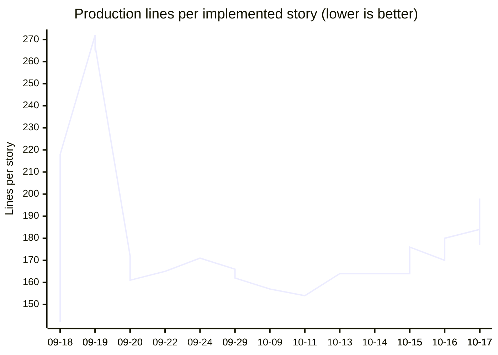
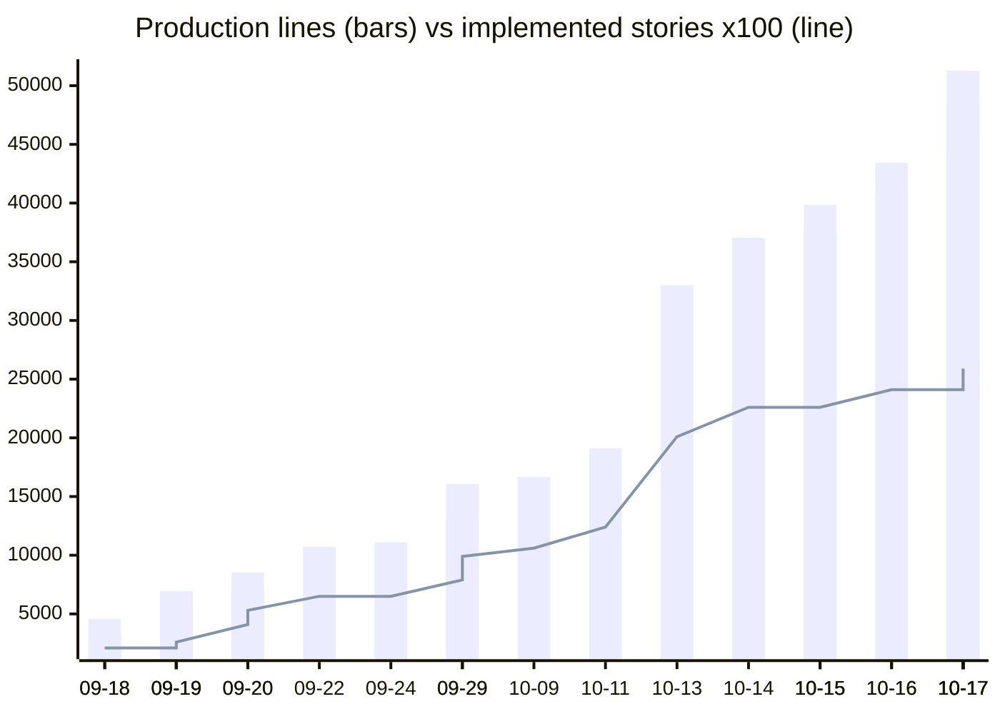

# Code health report

_Generated 2026-10-17 by `python -m tools.code_health report`. Do not edit by hand: rerun the command (or `python -m tools.docs sync`) to refresh it. How each measure is computed is described in [tools/code_health/README.md](../../tools/code_health/README.md)._

## Scorecard

| Measure | Backend (Python) | Frontend (TS/React) | Target | Status |
|---|---|---|---|---|
| Production code (non-blank lines) | 33,733 | 18,087 | - |  |
| Test code (non-blank lines) | 13,873 | 3,811 | - |  |
| Functions measured | 1746 | 710 | - |  |
| Mean cognitive complexity / function | 4.11 | 4.61 | <= 6 | OK |
| Functions over cognitive 15 | 90 | 51 | ratchet: must not rise |  |
| Functions over cyclomatic 10 | 133 | 71 | ratchet: must not rise |  |
| Duplicated lines | 0.21% | 0.08% | <= 5.0% | OK |
| Structural duplication (renamed copies) | 3.73% | 0.57% | ratchet |  |
| Import cycles (module level, import-time) | 0 | 0 | 0 | OK |
| Package cycles (incl. lazy imports) | 1 | 1 | ratchet |  |
| Unused definitions / exports | 15 | 11 | ratchet |  |
| Unused dependencies | 2 | 0 | 0 | **Attention** |
| Mutation score (mean of measured modules) | 0.74 | - | >= 0.7 | OK |

## 1. Complexity

Cognitive complexity measures how hard a function is to *read* (nesting is penalised); cyclomatic complexity counts independent paths, i.e. the minimum number of tests to cover every branch. Limits: cognitive 15, cyclomatic 10.

### Most complex functions

| Function | File | Cognitive | Cyclomatic | Lines |
|---|---|---|---|---|
| `run_orchestration` | `backend/app/twin/orchestrator.py:251` | 99 | 56 | 515 |
| `DigitalTwinAdvancedPanel` | `frontend/src/components/DigitalTwinAdvancedPanel.tsx:48` | 93 | 51 | 466 |
| `BlueprintPage` | `frontend/src/pages/BlueprintPage.tsx:34` | 91 | 71 | 421 |
| `batch_results` | `backend/app/batches/results.py:201` | 78 | 67 | 111 |
| `OrchestrationPanel` | `frontend/src/components/OrchestrationPanel.tsx:53` | 65 | 37 | 433 |
| `run_orchestration.run_task_node` | `backend/app/twin/orchestrator.py:407` | 63 | 37 | 117 |
| `merge_process_schemas` | `backend/app/ingestion/merge.py:37` | 62 | 24 | 80 |
| `patch_group` | `backend/app/scim/service.py:354` | 60 | 35 | 48 |
| `_sanitize_situation` | `backend/app/twin/test_builder.py:264` | 57 | 52 | 72 |
| `execute` | `backend/app/runtime/executor.py:174` | 56 | 37 | 288 |
| `_apply_operation` | `backend/app/bpmn/chat_ops.py:81` | 53 | 36 | 71 |
| `BatchResultsPage` | `frontend/src/pages/BatchResultsPage.tsx:41` | 53 | 44 | 243 |
| `compliance_evidence` | `backend/app/context/compliance.py:89` | 52 | 37 | 94 |
| `BatchPanel` | `frontend/src/components/datasets/BatchPanel.tsx:32` | 52 | 33 | 215 |
| `Console` | `frontend/src/operator/OperatorConsole.tsx:337` | 52 | 48 | 224 |

### Longest functions

| Function | File | Lines | Cognitive |
|---|---|---|---|
| `TwinTestBuilder` | `frontend/src/components/TwinTestBuilder.tsx:85` | 549 | 51 |
| `run_orchestration` | `backend/app/twin/orchestrator.py:251` | 515 | 99 |
| `DigitalTwinAdvancedPanel` | `frontend/src/components/DigitalTwinAdvancedPanel.tsx:48` | 466 | 93 |
| `OrchestrationPanel` | `frontend/src/components/OrchestrationPanel.tsx:53` | 433 | 65 |
| `BlueprintPage` | `frontend/src/pages/BlueprintPage.tsx:34` | 421 | 91 |
| `execute` | `backend/app/runtime/executor.py:174` | 288 | 56 |
| `DiagramPage` | `frontend/src/pages/DiagramPage.tsx:11` | 280 | 44 |
| `TestDataKitchen` | `frontend/src/components/TestDataKitchen.tsx:32` | 266 | 38 |
| `ProcessDetailPage` | `frontend/src/pages/ProcessDetailPage.tsx:49` | 266 | 48 |
| `OraclePanel` | `frontend/src/components/datasets/OraclePanel.tsx:28` | 265 | 38 |

## 2. Duplication

Copy-paste clones of at least 70 tokens and 6 lines, ignoring whitespace and comments, in production code.

**Backend:** 72 of 33,733 lines (0.21%) sit in 3 exact clone pairs; 3.73% sit in 54 structural clones (same shape with identifiers and literals renamed, at least 100 tokens and 10 lines).

| Tokens | Lines | First copy | Second copy |
|---|---|---|---|
| 89 | 12 | `backend/app/api/oidc.py:126-137` | `backend/app/api/operator.py:203-212` |
| 85 | 11 | `backend/app/auth/support.py:140-150` | `backend/app/tenancy/onboarding.py:171-181` |
| 85 | 14 | `backend/app/db/repository.py:1378-1391` | `backend/app/db/repository.py:1965-1978` |

Largest structural clones (backend):

| Tokens | Lines | First copy | Second copy |
|---|---|---|---|
| 283 | 34 | `backend/app/api/orchestration.py:45-78` | `backend/app/api/twin.py:57-90` |
| 242 | 34 | `backend/app/api/evaluation.py:11-44` | `backend/app/api/orchestration.py:12-43` |
| 223 | 31 | `backend/app/main.py:145-174` | `backend/app/main.py:159-189` |
| 185 | 33 | `backend/app/db/repository.py:1693-1724` | `backend/app/db/repository.py:2088-2120` |
| 168 | 22 | `backend/app/db/models.py:1759-1777` | `backend/app/db/models.py:2119-2140` |
| 149 | 27 | `backend/app/db/repository.py:942-968` | `backend/app/db/repository.py:1693-1718` |
| 149 | 27 | `backend/app/db/repository.py:942-968` | `backend/app/db/repository.py:2088-2113` |
| 143 | 17 | `backend/app/db/models.py:1063-1076` | `backend/app/db/models.py:1175-1191` |

**Frontend:** 14 of 18,087 lines (0.08%) sit in 1 exact clone pairs; 0.57% sit in 2 structural clones (same shape with identifiers and literals renamed, at least 100 tokens and 10 lines).

| Tokens | Lines | First copy | Second copy |
|---|---|---|---|
| 81 | 7 | `frontend/src/components/org/ApplicableContextView.tsx:48-54` | `frontend/src/components/org/PolicyReviewPanel.tsx:145-151` |

Largest structural clones (frontend):

| Tokens | Lines | First copy | Second copy |
|---|---|---|---|
| 156 | 11 | `frontend/src/components/org/ApplicableContextView.tsx:46-56` | `frontend/src/components/ProcessScopeEditor.tsx:78-88` |
| 110 | 43 | `frontend/src/components/DigitalTwinPreview.tsx:26-64` | `frontend/src/components/DigitalTwinPreviewOrchestrated.tsx:32-74` |

## 3. Hotspots (churn x complexity)

Files that are both complicated and frequently changed. Score = commits touching the file x the sum of its functions' cognitive complexity. Refactoring the top of this list pays back fastest.

| File | Commits | Lines changed | Cognitive (sum) | Lines | Score |
|---|---|---|---|---|---|
| `backend/app/db/repository.py` | 23 | 2,864 | 337 | 2168 | 7,751 |
| `frontend/src/api/client.ts` | 31 | 1,711 | 71 | 1252 | 2,201 |
| `frontend/src/pages/BlueprintPage.tsx` | 12 | 542 | 106 | 420 | 1,272 |
| `backend/app/twin/orchestrator.py` | 5 | 1,304 | 251 | 692 | 1,255 |
| `backend/app/api/runtime.py` | 7 | 981 | 157 | 782 | 1,099 |
| `backend/app/oracles/service.py` | 4 | 755 | 241 | 582 | 964 |
| `backend/app/twin/engine.py` | 10 | 1,649 | 84 | 354 | 840 |
| `frontend/src/pages/ProcessDetailPage.tsx` | 10 | 370 | 74 | 287 | 740 |
| `backend/app/runtime/deployments.py` | 5 | 627 | 129 | 463 | 645 |
| `backend/app/llm/client.py` | 7 | 385 | 85 | 313 | 595 |
| `backend/app/runtime/jobs.py` | 5 | 897 | 113 | 469 | 565 |
| `frontend/src/pages/DiagramPage.tsx` | 8 | 326 | 68 | 261 | 544 |
| `backend/app/jobs/worker.py` | 11 | 366 | 49 | 236 | 539 |
| `backend/app/context/ingestion.py` | 3 | 665 | 175 | 553 | 525 |
| `frontend/src/components/OrchestrationPanel.tsx` | 5 | 525 | 103 | 461 | 515 |

## 4. Coupling and dependency cycles

Ca = how many internal packages depend on this one; Ce = how many it depends on; instability I = Ce/(Ca+Ce). Packages near I=0 should be stable foundations; near I=1 should be leaves.

### Backend packages

| Package | Ca (in) | Ce (out) | Instability |
|---|---|---|---|
| `app.db` | 21 | 16 | 0.43 |
| `app.api` | 1 | 28 | 0.97 |
| `app.context` | 11 | 11 | 0.5 |
| `app.llm` | 15 | 7 | 0.32 |
| `app.runtime` | 4 | 17 | 0.81 |
| `app.ids` | 20 | 0 | 0.0 |
| `app.jobs` | 9 | 11 | 0.55 |
| `app.schemas` | 19 | 1 | 0.05 |
| `app.tenancy` | 14 | 6 | 0.3 |
| `app.config` | 19 | 0 | 0.0 |
| `app.connectors` | 6 | 11 | 0.65 |
| `app.batches` | 6 | 10 | 0.62 |
| `app.oracles` | 6 | 10 | 0.62 |
| `app.twin` | 5 | 10 | 0.67 |
| `app.process_twin` | 2 | 10 | 0.83 |
| `app.auth` | 6 | 5 | 0.45 |
| `app.bpmn` | 8 | 3 | 0.27 |
| `app.datasets` | 7 | 4 | 0.36 |
| `app.ingestion` | 3 | 8 | 0.73 |
| `app.main` | 1 | 10 | 0.91 |
| `app.catalog` | 4 | 6 | 0.6 |
| `app.operators` | 1 | 8 | 0.89 |
| `app.store` | 9 | 0 | 0.0 |
| `app.secret_store` | 6 | 1 | 0.14 |
| `app.gap_analysis` | 2 | 4 | 0.67 |
| `app.registry` | 2 | 4 | 0.67 |
| `app.scim` | 2 | 4 | 0.67 |
| `app.agents` | 2 | 2 | 0.5 |
| `app.blueprint` | 1 | 3 | 0.75 |
| `app.chat` | 1 | 3 | 0.75 |
| `app.request_context` | 2 | 2 | 0.5 |

### Most-coupled backend modules

| Module | Ca (in) | Ce (out) | Instability |
|---|---|---|---|
| `app.db.models` | 80 | 0 | 0.0 |
| `app.db.repository` | 30 | 44 | 0.59 |
| `app.ids` | 55 | 0 | 0.0 |
| `app.config` | 51 | 0 | 0.0 |
| `app.main` | 1 | 41 | 0.98 |
| `app.api.deps` | 31 | 10 | 0.24 |
| `app.jobs.worker` | 14 | 16 | 0.53 |
| `app.api.runtime` | 1 | 27 | 0.96 |
| `app.tenancy.identity` | 23 | 5 | 0.18 |
| `app.db.session` | 23 | 4 | 0.15 |

### Frontend directories

| Directory | Ca (in) | Ce (out) | Instability |
|---|---|---|---|
| `frontend/brandassets` | 1 | 0 | 0.0 |
| `frontend/src` | 0 | 5 | 1.0 |
| `frontend/src/api` | 8 | 0 | 0.0 |
| `frontend/src/auth` | 4 | 3 | 0.43 |
| `frontend/src/components` | 4 | 5 | 0.56 |
| `frontend/src/components/datasets` | 2 | 1 | 0.33 |
| `frontend/src/components/org` | 2 | 2 | 0.5 |
| `frontend/src/lib` | 3 | 1 | 0.25 |
| `frontend/src/operator` | 0 | 3 | 1.0 |
| `frontend/src/pages` | 1 | 7 | 0.88 |
| `frontend/src/styles` | 2 | 0 | 0.0 |

### Cycles

- Backend module cycles at import time: **0**
- Backend module cycles including function-level (lazy) imports: **4** (84 lazy import edges in total -- usually a sign a cycle was dodged rather than removed)
- Backend package cycles including lazy imports: **1**
- Frontend file cycles: **0**, directory cycles: **1**

**Backend package cycles (incl. lazy imports):**

- `app.agents` <-> `app.api` <-> `app.auth` <-> `app.batches` <-> `app.blueprint` <-> `app.bpmn` <-> `app.catalog` <-> `app.chat` ... (27 nodes)

**Backend module cycles (incl. lazy imports):**

- `app.api.batches` <-> `app.api.connectors` <-> `app.api.data_export` <-> `app.api.operator` <-> `app.api.process_twin` <-> `app.api.runtime` <-> `app.connectors.jobs` <-> `app.context.jobs` ... (22 nodes)
- `app.db.session` <-> `app.tenancy.databases` (2 nodes)
- `app.context.consumers` <-> `app.db.repository` (2 nodes)
- `app.runtime.adapters` <-> `app.runtime.credentials` (2 nodes)

## 5. Dead code and unused dependencies

- Python: **15** definitions never referenced; **7** referenced only by tests.
- TypeScript: **11** exports never imported; **4** imported only by tests; **85** exported but only used inside their own file (drop the `export`); **0** files unreachable from `main.tsx`.

Name-based detection: confirm before deleting (a dynamic `getattr`, a string route, or an external caller can keep a symbol alive).

| Symbol | Kind | Where |
|---|---|---|
| `bpmn_id_for_lane` | function | `backend/app/bpmn/chat_ops.py:45` |
| `citations_from_labels` | function | `backend/app/context/consumers.py:178` |
| `delete_policy_file` | function | `backend/app/context/ingestion.py:86` |
| `get_entity` | function | `backend/app/context/repository.py:174` |
| `get_entity_version_snapshot` | function | `backend/app/context/repository.py:328` |
| `list_context_documents` | function | `backend/app/context/repository.py:438` |
| `cited_entities` | function | `backend/app/context/resolver.py:399` |
| `list_schema_changes` | function | `backend/app/db/repository.py:331` |
| `_set_transaction_tenant` | function | `backend/app/db/session.py:74` |
| `registered_kinds` | function | `backend/app/jobs/worker.py:62` |
| `grand_total_cost_usd` | method | `backend/app/llm/usage.py:144` |
| `Timestamped` | class | `backend/app/schemas/common.py:55` |
| `VersionDiffRequest` | class | `backend/app/schemas/versions.py:30` |
| `run_export` | function | `backend/app/tenancy/export.py:200` |
| `is_console_tenant` | function | `backend/app/tenancy/onboarding.py:210` |
| `updateAgentGovernance` | export | `frontend/src/api/client.ts:546` |
| `pushToRegistry` | export | `frontend/src/api/client.ts:680` |
| `cancelTwinRun` | export | `frontend/src/api/client.ts:782` |
| `resumeTwinRun` | export | `frontend/src/api/client.ts:786` |
| `updateOrganization` | export | `frontend/src/api/client.ts:951` |
| `listPolicyPassages` | export | `frontend/src/api/client.ts:1023` |
| `getProcessScope` | export | `frontend/src/api/client.ts:1036` |
| `previewContextPack` | export | `frontend/src/api/client.ts:1049` |
| `getDataset` | export | `frontend/src/api/client.ts:1176` |
| `addDatasetRows` | export | `frontend/src/api/client.ts:1190` |
| `DocumentDetail` | export | `frontend/src/api/types.ts:72` |

| Manifest | Package | Why flagged |
|---|---|---|
| pyproject.toml [dependencies] | `pyjwt` | no `import pyjwt` found |
| pyproject.toml [optional-dependencies.dev] | `markdown` | no `import markdown` found |

## 6. Code growth vs feature growth

Production lines per API endpoint and per implemented user story, at every commit. A rising line means each new feature costs more code than the last (accidental complexity); flat or falling means the codebase is absorbing features through reuse.

|  | First commit | Latest commit | Change |
|---|---|---|---|
| Production lines | 2,985 | 51,286 | x17.2 |
| Test lines | 1,577 | 17,551 | x11.1 |
| API endpoints | 22 | 277 | x12.6 |
| User stories implemented | 21 | 259 | x12.3 |
| Lines per endpoint | 136 | 185 |  |
| Lines per implemented story | 142 | 198 |  |
| Test lines per production line | 0.53 | 0.34 |  |

## 7. Mutation score

Share of deliberately injected bugs (flipped comparison, and/or swap, off-by-one, ...) that the tests catch. Coverage says a line ran; mutation score says the tests would notice if it were wrong. Run `python -m tools.code_health mutation --module <path>` to measure a module.

| Module | Score | Killed | Survived | Tested / sites | Measured | Tests |
|---|---|---|---|---|---|---|
| `app/twin/orchestrator.py` | 56% | 14 | 11 | 25 / 172 | 2026-10-13 | `tests/test_orchestrator.py` |
| `app/oracles/rules.py` | 68% | 17 | 8 | 25 / 116 | 2026-10-13 | `tests/test_oracles.py` |
| `app/batches/results.py` | 72% | 18 | 7 | 25 / 239 | 2026-10-13 | `tests/test_results.py` |
| `app/process_twin/efficiency.py` | 76% | 19 | 6 | 25 / 167 | 2026-10-13 | `tests/test_process_twin.py` |
| `app/twin/gateway.py` | 84% | 21 | 4 | 25 / 39 | 2026-10-13 | `tests/test_twin_gateway.py` |
| `app/twin/records.py` | 88% | 22 | 3 | 25 / 74 | 2026-10-13 | `tests/test_process_twin.py` |

Surviving mutants (each is a test that's missing):

| Module | Line | Mutation |
|---|---|---|
| `app/oracles/rules.py` | 31 | number 0 -> 1 |
| `app/oracles/rules.py` | 31 | number 2 -> 3 |
| `app/oracles/rules.py` | 38 | number 0 -> 1 |
| `app/oracles/rules.py` | 110 | return value -> None |
| `app/oracles/rules.py` | 125 | return value -> None |
| `app/oracles/rules.py` | 137 | constant False -> True |
| `app/oracles/rules.py` | 174 | constant False -> True |
| `app/oracles/rules.py` | 51 | arithmetic Add -> Sub |
| `app/twin/gateway.py` | 102 | number 0 -> 1 |
| `app/twin/gateway.py` | 118 | comparison Gt -> GtE |
| `app/twin/gateway.py` | 146 | comparison Gt -> GtE |
| `app/twin/gateway.py` | 160 | arithmetic Sub -> Add |
| `app/batches/results.py` | 63 | number 0 -> 1 |
| `app/batches/results.py` | 247 | boolean or -> and |
| `app/batches/results.py` | 51 | number 0 -> 1 |
| `app/batches/results.py` | 56 | number 4 -> 5 |
| `app/batches/results.py` | 247 | comparison Is -> IsNot |
| `app/batches/results.py` | 366 | number 4 -> 5 |
| `app/batches/results.py` | 503 | comparison Eq -> NotEq |
| `app/twin/orchestrator.py` | 118 | number 0 -> 1 |
| `app/twin/orchestrator.py` | 158 | return value -> None |
| `app/twin/orchestrator.py` | 223 | number 50 -> 51 |
| `app/twin/orchestrator.py` | 251 | return value -> None |
| `app/twin/orchestrator.py` | 261 | return value -> None |
| `app/twin/orchestrator.py` | 65 | boolean or -> and |

