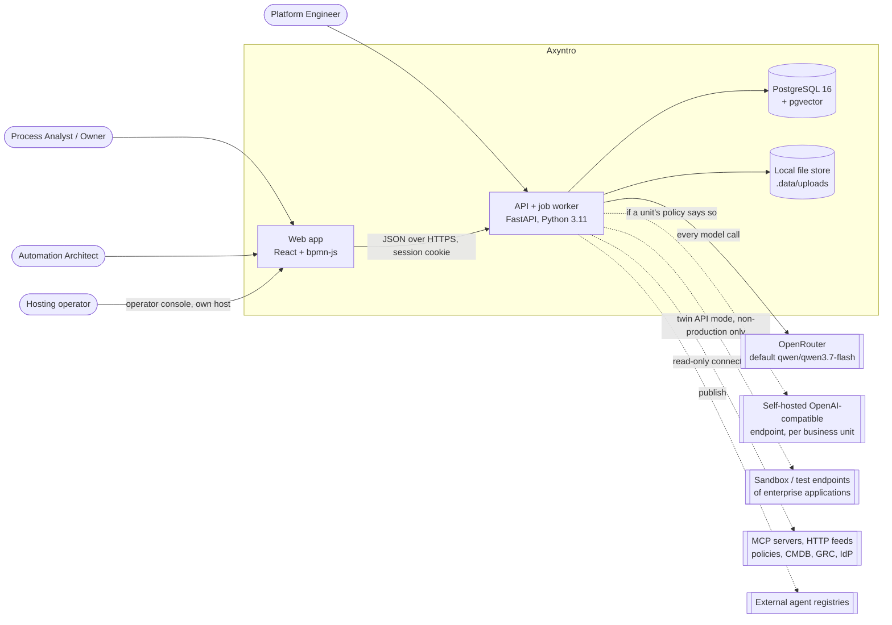
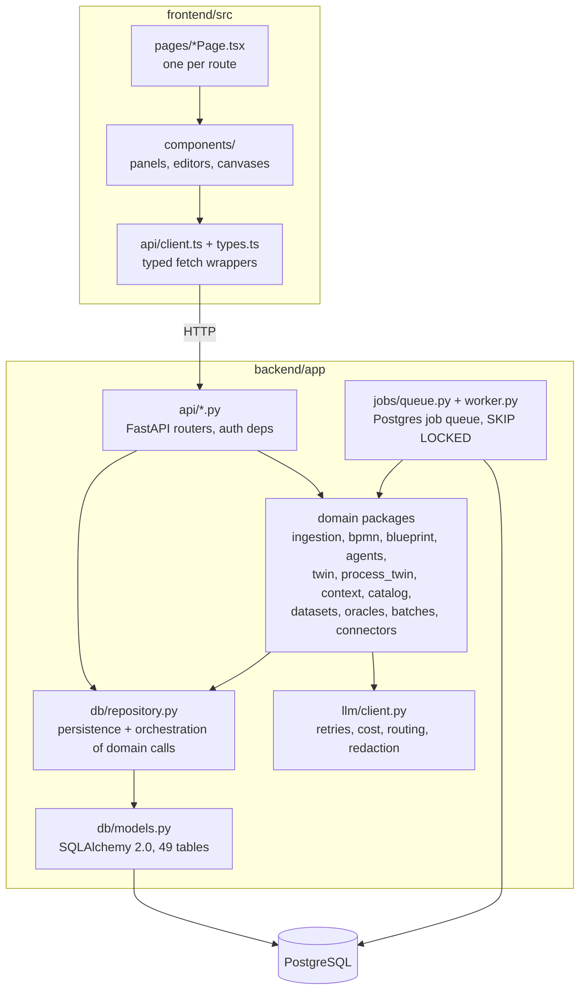
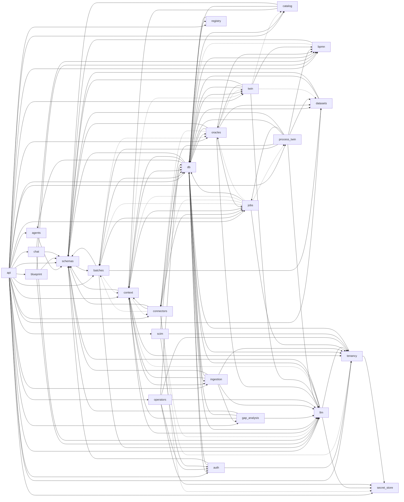
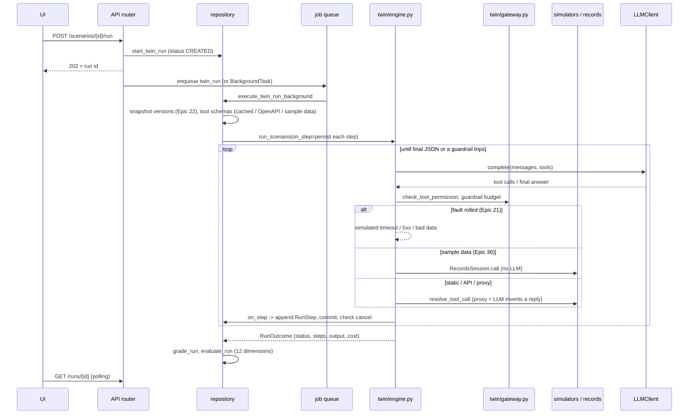
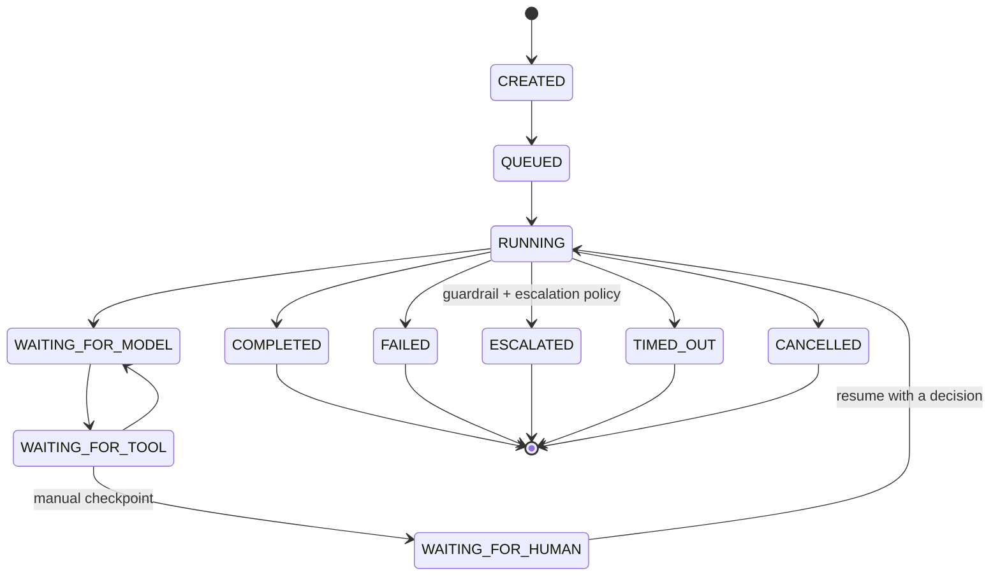
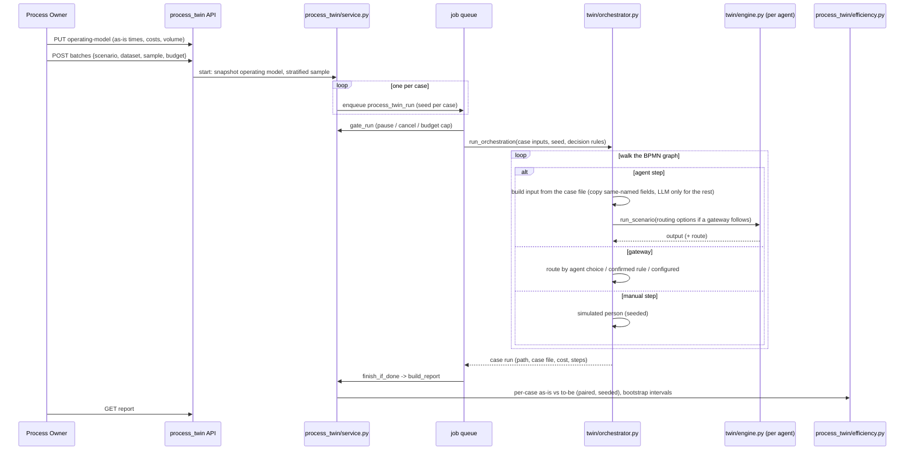
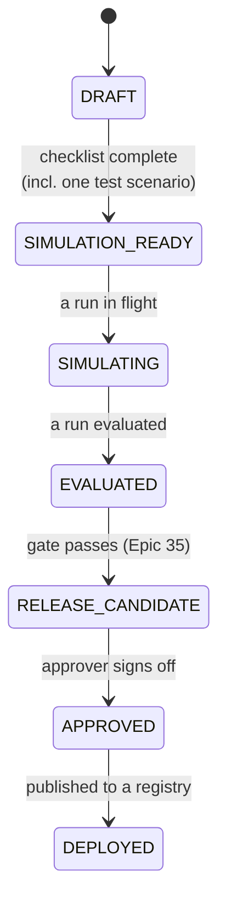

# Architecture

Last reviewed: 2026-10-16 · Sources: `backend/app`, `frontend/src`, `docker-compose.yml`, `planning/epics`

Axyntro turns business-process documentation into a reviewed BPMN
process, evaluates every step for AI-agent automation, generates agent
definitions, and tests them in a digital twin: one agent at a time, at
volume, and now (Epic 36) as a whole process before anything reaches
production. This page describes how it is built. [Data Model](Data-Model.md)
covers the database, [Prompts and LLM](Prompts-and-LLM.md) every model
call, and [Critical Review](Critical-Review.md) where the design is weak.

## 1. System context



Everything runs locally under Docker Compose (`docker-compose.yml`;
`docker-compose.sso.yml` adds Keycloak as the identity provider):
`db` (pgvector/pgvector:pg16), `api` (runs `alembic upgrade head`, then
uvicorn, and by default the job worker inside the same process), and `web`
(the Vite build served by nginx). `start.ps1` brings it up. `-Demo` switches
to a separate demo database, and `-SeedProcessTwin` seeds the Epic 36 demo.

## 2. Containers and layers



The layering is a convention, not an enforced boundary. Routers call both
domain packages and the repository. The repository also *drives* domain
work: `execute_twin_run_background` and `execute_orchestration_run_background`
live in `db/repository.py`. That is why it is the codebase's top hotspot (see
[Code Health](Code-Health.md)).

### Backend packages

<!-- BEGIN GENERATED: module-inventory -->
| Package | Files | Lines | Purpose (from its docstring) |
|---|---|---|---|
| `app/agents` | 3 | 241 | Epic 12, US12.1/US12.2: deterministic mapping from a blueprint node's AgentSpec (Epic 7) to a portable AgentDefinition. No LLM call here -- the blueprint evalua |
| `app/api` | 32 | 4,122 |  |
| `app/auth` | 9 | 1,649 | Epic 37, US37.6: the append-only audit trail. |
| `app/batches` | 3 | 849 | Epic 34: batch execution at volume. |
| `app/blueprint` | 3 | 219 | Epic 7 / agentic-blueprint-evaluator skill: the system instructions + JSON response contract for per-node automation feasibility evaluation. Same prompt-with-ex |
| `app/bpmn` | 7 | 983 | US3.1/US3.3: turn a process's already-extracted ProcessSchema into valid BPMN 2.0 XML with Diagram Interchange. |
| `app/catalog` | 4 | 586 | Epic 29: the application and data catalog. |
| `app/chat` | 3 | 232 | Epic 5 / bpmn-chat-ops skill: the system instructions + JSON response contract for chat-driven diagram editing. Follows the same prompt-with-explicit-schema-con |
| `app/connectors` | 7 | 658 | Epic 31, US31.2: read-only connectors to systems of record. |
| `app/context` | 13 | 2,389 | Epics 27-28: the organization context layer -- see planning/enterprise-context-strategy.md. |
| `app/datasets` | 3 | 548 | Epic 32: labelled datasets and ground truth. |
| `app/db` | 4 | 3,733 | SQLAlchemy ORM models for Epic 2 (Business Process Knowledge Store) -- processes, documents, the extracted process schema (actors/elements/ source_refs/flows),  |
| `app/gap_analysis` | 3 | 282 | Epic 11: the system instructions + JSON response contract for gap analysis. Same prompt-with-explicit-schema-contract pattern as app/chat/prompts.py/app/bluepri |
| `app/ingestion` | 7 | 824 | US2.3: local embedding generation for extracted document content. |
| `app/jobs` | 3 | 331 | Epic 31, US31.1: the durable job queue. |
| `app/llm` | 7 | 760 |  |
| `app/operators` | 3 | 234 | Epic 38, US38.8: the operator console -- the hosting company's own view of the deployment, separate from every tenant. |
| `app/oracles` | 5 | 818 | Epic 33: scalable oracles -- rules, label-first generation, metamorphic relations, calibrated judges. |
| `app/process_twin` | 4 | 604 | Epic 36: the process digital twin -- the whole process run over many cases, measured against today. |
| `app/registry` | 4 | 201 | Epic 13, US13.1: the registry connector interface every registry backend implements identically -- the local reference connector (app/registry/local.py) today,  |
| `app/schemas` | 27 | 2,346 |  |
| `app/scim` | 3 | 491 | Epic 37, US37.10: the inbound SCIM 2.0 server (RFC 7643/7644) the customer's IdP provisions users and groups through. Not Epic 31's outbound ScimConnector, whic |
| `app/secret_store` | 1 | 104 | Epic 38, US38.10: each tenant's secrets, kept apart. |
| `app/tenancy` | 8 | 610 | Epic 38: many organizations ("tenants") on one deployment, kept apart by Postgres row-level security. See planning/epics/38-multi-tenancy.md. |
| `app/twin` | 14 | 2,654 | Epic 19, US19.4: a plain-English behavioral diff between two runs -- typically two versions of the same agent (US19.5's `AgentArtifact.version`), but works for  |
<!-- END GENERATED: module-inventory -->

### Package dependencies

<!-- BEGIN GENERATED: module-graph -->


Solid: imported at module load. Dashed: imported inside a function only (a 'lazy' import, usually there to dodge an import cycle). Omitted for readability: `ids`, `config`, `store`, `request_context` (used everywhere) and `main` (imports every router).
<!-- END GENERATED: module-graph -->

## 3. The product pipeline

```mermaid
flowchart LR
    A[Upload documents<br/>PDF, DOCX, VSDX, images] --> B[Extract process<br/>LLM: document_extraction]
    B --> C[Gap analysis<br/>LLM: gap_analysis]
    C --> D[Generate BPMN<br/>deterministic builder + layout]
    D --> E[Refine by chat<br/>LLM: chat_edit -> diff -> confirm]
    E --> F[Finalize baseline<br/>immutable version]
    F --> G[Agentic blueprint<br/>LLM: blueprint_evaluation<br/>+ context pack]
    G --> H[Agent artifacts<br/>deterministic from the blueprint]
    H --> I[Digital twin<br/>one agent, scenarios]
    I --> J[Volume testing<br/>datasets, oracles, batches]
    J --> K[Release gate<br/>statistical criteria]
    H --> L[Process twin<br/>all agents, many cases]
    L --> K
    K --> M[Publish to registry]
    O[(Organization context<br/>policies, rules, catalog)] -. context packs .-> C
    O -. .-> G
    O -. .-> H
    O -. .-> I
```

Design choices that recur:

- **LLMs judge, code renders.** The model decides *what* a process or
  agent is. Deterministic code turns that decision into BPMN XML
  (`bpmn/builder.py`, `bpmn/layout.py`) and agent definitions
  (`agents/generation.py`), so outputs are valid by construction and
  testable without a model.
- **Structured output, validated.** Every model call asks for JSON,
  validates it with Pydantic, and treats a malformed answer as a domain
  error (HTTP 502), never as data.
- **Finalized versions are immutable.** Blueprints, agents and scenarios
  pin the baseline version they were made from, and staleness is
  computed, not stored.
- **Twin runs are traces, not opinions.** Pass/fail compares the recorded
  steps and outputs with expectations. An LLM judge is used only for free
  text, and only after calibration (Epic 33).

## 4. How a twin run executes

One agent, one scenario (Epics 14, 17, 20, 21, 36):



A human checkpoint is just another tool (`request_human_decision`). It's
answered by a simulated reviewer (probability or rule), or the run
suspends as `WAITING_FOR_HUMAN` and resumes from a serialized
`resume_state`.



## 5. How the process twin executes (Epic 36)



The agent lifecycle (Epic 23) is derived from data rather than stored:



## 6. Cross-cutting

| Concern | How it's done today | Where |
|---|---|---|
| Authentication | `AUTH_MODE=oidc`: the API runs the OIDC code flow with PKCE against the customer's IdP, verifies the ID token and MFA (`amr`/`acr`), and matches people by issuer and subject. `AUTH_MODE=local` (a name and self-picked roles) is for development and demos only. Sessions: a 15-minute session cookie renewed from a rotating refresh cookie (hashed tokens, reuse detection), a 30-minute idle timeout and a 12-hour cap, a CSRF header on writes, and revocation by the user, an admin or the IdP. SCIM provisioning (`/scim/v2`) and group-to-role mappings keep people and roles in step with the directory. SAML is still to come (see the [Glossary](Glossary.md)) | `auth/oidc.py`, `api/oidc.py`, `scim/`, `api/scim.py`, `auth/directory.py`, `auth/sessions.py`, `api/auth.py`, `api/deps.py` |
| Tenancy | Each customer is a tenant, reached at its own host names. A middleware resolves the host before routing (unknown host: 404; suspended: 403). Every transaction sets `app.tenant_id`, and Postgres row-level security on every table does the rest; the API connects as a role that can't bypass it. Jobs run as their tenant. Each tenant has its own IdP (`tenant_identity`, the Directory page), with providers cached per tenant. The operator console has its own host, IdP, sessions and audit log, and connects as a role with no privilege on tenant tables; operators enter a tenant only as support, under a grant its admin gave. Secrets, files and quotas aren't per tenant yet (Epic 38, step 3) | `tenancy/`, `operators/`, `auth/support.py`, `db/session.py`, `jobs/worker.py`, `auth/oidc.py`, migrations `f2a3b4c5d6e7`, `a3b4c5d6e7f8`, `b4c5d6e7f8a9` |
| Authorization | Six roles mapped to permissions, scoped to the organization or a business unit. Every write route declares the permission it needs. Segregation of duties is enforced on the change history, and every privileged action goes to an append-only audit log. Organization-context visibility is separate (Epic 31 memberships) | `auth/permissions.py`, `auth/sod.py`, `auth/audit.py`, `api/deps.py`, `context/access.py` |
| LLM governance | Per-business-unit policy: provider allow-list, residency, self-hosted endpoint, PII redaction; usage and cost logged per operation | `llm/routing.py`, `llm/client.py`, `llm/usage.py` |
| Background work | Postgres job queue (`jobs` table, SKIP LOCKED, leases, retries with backoff), worker in the API process by default | `jobs/` |
| Reproducibility | Every run snapshots agent, environment, dataset, model and policy versions; batch cases have per-case seeds | `twin/snapshot.py`, `batches/service.py` |
| Production safety | Twin API mode only calls endpoints tagged non-production on allow-listed hosts, re-checked per call | `catalog/endpoints.py` |
| Logging | Request correlation id, JSON-ish app log file, LLM usage JSONL | `request_context.py`, `main.py` |
| Configuration | `pydantic-settings` from `backend/.env` | `config.py` |
| Schema migration | Alembic, applied at container start | `backend/migrations` |

## 7. Frontend

A single-page React 19 app (Vite, react-router, bpmn-js for diagrams). No
global state library: each page loads what it needs through
`api/client.ts` (typed `fetch` wrappers, cookie credentials) and polls
while work runs in the background. `api/client.ts` also sends the CSRF
header on writes, and on a 401 it refreshes the session once and retries
(Epic 37, US37.12). Routes:

| Route | Page |
|---|---|
| `/` | Process list |
| `/processes/:id` | Process detail (documents, status, navigation) |
| `/processes/:id/diagram` | BPMN editor + chat |
| `/processes/:id/versions` | Finalized versions and diffs |
| `/processes/:id/gaps` | Gap review |
| `/processes/:id/blueprint` | Blueprint, agents, digital twin tabs |
| `/processes/:id/datasets` | Golden cases, rules, batches |
| `/processes/:id/batches/:batchId` | Batch results and release gate |
| `/processes/:id/process-twin` | Process twin: operating model, runs, efficiency report (Epic 36) |
| `/organization` | Organization context, catalog, connectors |
| `/registries` | Agent registries |
| `/audit` | Audit log with filters and CSV export (Auditor, Approver, Admin) |
| `/users` | Users, roles and scopes, sessions, approval policy (Admin) |
| `/sessions` | Your own sessions, with "End session" for any other browser (Epic 37) |
| `/directory` | Sign-in settings, support access, SCIM tokens and group-to-role mappings, with a preview of who gains or loses what (Admin, Epics 37-38) |

On an operator host, `main.tsx` loads the operator console
(`frontend/src/operator/`) instead, chosen by `GET /api/host`.

## 8. Planning map

<!-- BEGIN GENERATED: epic-index -->
| Epic | Stories | Status (from the epic file) |
|---|---|---|
| [Epic 1 -- Document Ingestion Pipeline](../../planning/epics/01-document-ingestion.md) | 8 | all 8 stories implemented |
| [Epic 2 -- Business Process Knowledge Store](../../planning/epics/02-knowledge-store.md) | 6 | all 6 stories implemented |
| [Epic 3 -- As-Is BPMN Generation Engine](../../planning/epics/03-bpmn-generation.md) | 7 | all 7 stories implemented |
| [Epic 4 -- Process Diagram UI](../../planning/epics/04-diagram-ui.md) | 6 | not stated |
| [Epic 5 -- Conversational Diagram Editing](../../planning/epics/05-chat-editing.md) | 6 | not stated |
| [Epic 6 -- Diagram Finalization and Versioning](../../planning/epics/06-finalization-versioning.md) | 4 | not stated |
| [Epic 7 -- Agentic Blueprint Generation Engine](../../planning/epics/07-agentic-blueprint-engine.md) | 7 | not stated |
| [Epic 8 -- Agentic Blueprint Interactive Visualization](../../planning/epics/08-blueprint-visualization.md) | 5 | not stated |
| [Epic 9 -- Platform Foundations](../../planning/epics/09-platform-foundations.md) | 10 | all 10 stories implemented |
| [Epic 10 -- Cross-Cutting / Non-Functional](../../planning/epics/10-nonfunctional.md) | 5 | all 5 stories implemented |
| [Epic 11 -- Process Gap Analysis & Clarification](../../planning/epics/11-gap-analysis-and-clarification.md) | 5 | implemented |
| [Epic 12 -- Agent Artifact Generation](../../planning/epics/12-agent-artifact-generation.md) | 6 | all 6 stories implemented |
| [Epic 13 -- Agent Registry Connectivity](../../planning/epics/13-agent-registry-connectivity.md) | 6 | all 6 stories implemented |
| [Epic 14 -- Digital Twin Simulation & Validation](../../planning/epics/14-digital-twin-simulation.md) | 6 | all 6 stories implemented |
| [Epic 15 -- Agent Publishing & Lifecycle Management](../../planning/epics/15-agent-publishing-lifecycle.md) | 6 | all 6 stories implemented |
| [Epic 16 -- Orchestration Rehearsal (multi-agent process rehearsal)](../../planning/epics/16-orchestration-rehearsal.md) | 7 | all 7 stories implemented |
| [Epic 17 -- Simulation Run Lifecycle & Execution Trace Model](../../planning/epics/17-simulation-run-lifecycle.md) | 6 | implemented (all six user stories) |
| [Epic 18 -- Live Observability: Synchronized Views, Inspector & Replay](../../planning/epics/18-live-observability.md) | 5 | implemented (all five user stories) |
| [Epic 19 -- Evaluation Dimensions, Regression Suites & Version Comparison](../../planning/epics/19-evaluation-and-regression.md) | 5 | fully implemented |
| [Epic 20 -- Agent Definition Governance: Permissions, Guardrails, Escalation & Tool Gateway Enforcement](../../planning/epics/20-agent-definition-governance.md) | 8 | US20.1/US20.2 fully implemented and enforced; US20.3/US20.4/ US20.5/US20.6 declared in... |
| [Epic 21 -- Digital Twin Environments & Fault Injection Catalog](../../planning/epics/21-twin-environments-and-fault-injection.md) | 4 | fully implemented |
| [Epic 22 -- Reproducibility: Execution Snapshots](../../planning/epics/22-reproducibility-snapshots.md) | 3 | fully implemented |
| [Epic 23 -- Agent Definition Quality Gate & Unified Release Lifecycle](../../planning/epics/23-quality-gate-and-release-lifecycle.md) | 4 | fully implemented |
| [Epic 24 -- Guided Digital Twin Test Builder](../../planning/epics/24-guided-twin-test-builder.md) | 7 | all 7 stories implemented |
| [Epic 25 -- Test Data Kitchen (Sample & AI-Generated Data Sources)](../../planning/epics/25-test-data-kitchen.md) | 7 | all 7 stories implemented |
| [Epic 26 -- Business-Readable Twin Results & Tab Consolidation](../../planning/epics/26-business-readable-twin-results.md) | 4 | US26.1 and US26.3 implemented |
| [Epic 27 -- Organization Context Foundation](../../planning/epics/27-organization-context-foundation.md) | 9 | implemented (2026-10-11) |
| [Epic 28 -- Context Resolver & Context Packs](../../planning/epics/28-context-resolver-and-packs.md) | 9 | implemented (2026-10-11) |
| [Epic 29 -- Application & Data Catalog](../../planning/epics/29-application-and-data-catalog.md) | 8 | implemented (2026-10-11) |
| [Epic 30 -- Compliance-Aware Testing & Release](../../planning/epics/30-compliance-aware-testing-and-release.md) | 7 | implemented (2026-10-11) |
| [Epic 31 -- Enterprise Connectors & Federation](../../planning/epics/31-enterprise-connectors-and-federation.md) | 10 | implemented (2026-10-11) |
| [Epic 32 -- Labelled Datasets & Ground Truth Management](../../planning/epics/32-labelled-datasets-and-ground-truth.md) | 8 | implemented (2026-10-11) |
| [Epic 33 -- Scalable Oracles: Rules, Label-First Generation, Metamorphic Tests & Calibrated Judges](../../planning/epics/33-scalable-oracles.md) | 7 | implemented (2026-10-11) |
| [Epic 34 -- Batch Execution at Volume](../../planning/epics/34-batch-execution-at-volume.md) | 10 | implemented (2026-10-11) |
| [Epic 35 -- Results at Volume & Statistical Release Gate](../../planning/epics/35-results-at-volume-and-statistical-gate.md) | 9 | implemented (2026-10-11) |
| [Epic 36 -- Process Digital Twin at Volume: Efficiency & Readiness](../../planning/epics/36-process-twin-efficiency.md) | 9 | implemented (2026-10-13), except US36.9 (still open) |
| [Epic 37 -- Enterprise Identity, Roles & Segregation of Duties](../../planning/epics/37-enterprise-identity-and-access.md) | 15 | build steps 1-4 implemented. Step 1 (2026-10-14): US37.1-37.6, US37.14, US37.15. Step... |
| [Epic 38 -- Multi-Tenancy: Many Organizations on One Deployment](../../planning/epics/38-multi-tenancy.md) | 15 | build step 1 implemented (2026-10-15): US38.1-38.5, the tenant boundary. Step 2 in... |
<!-- END GENERATED: epic-index -->
