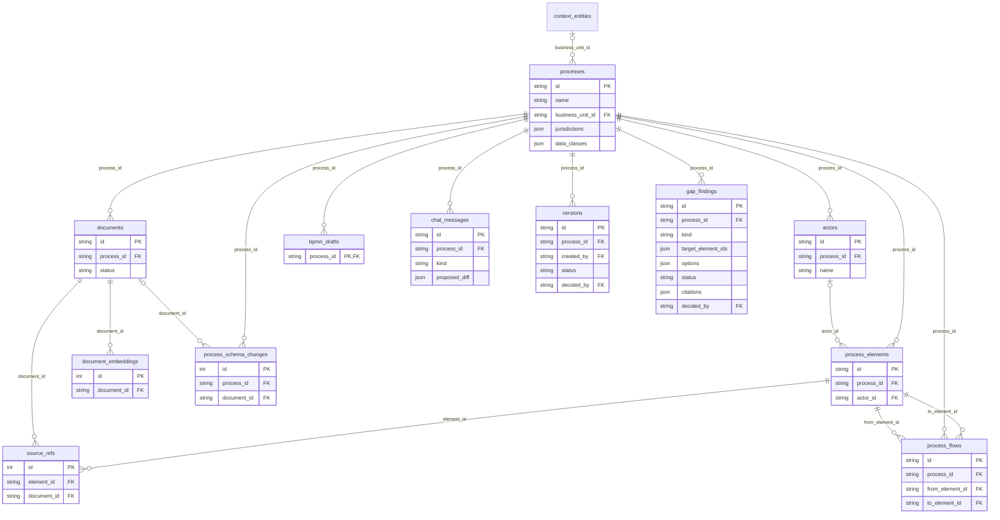
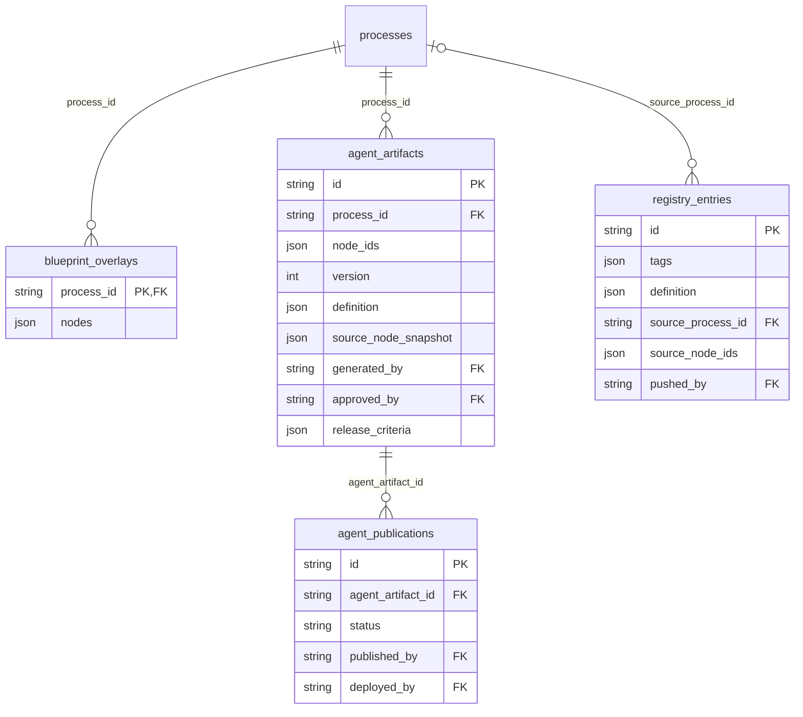
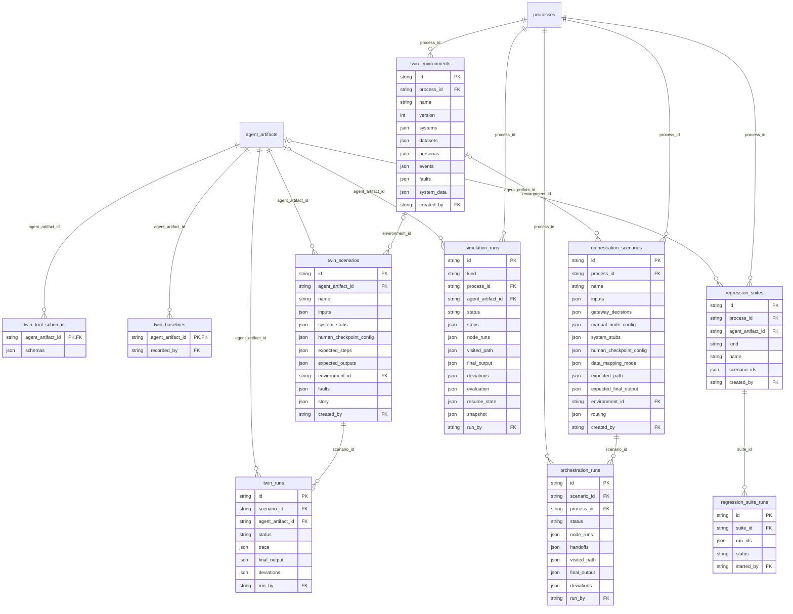
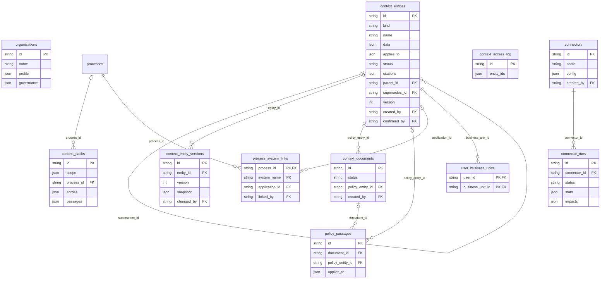
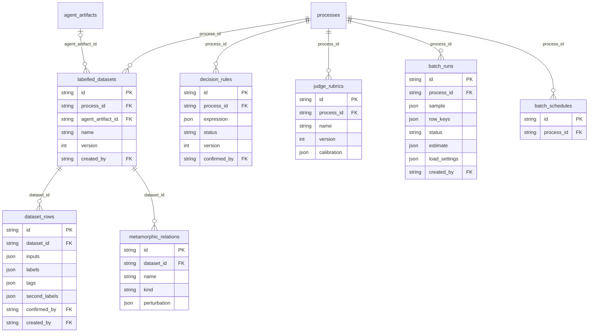
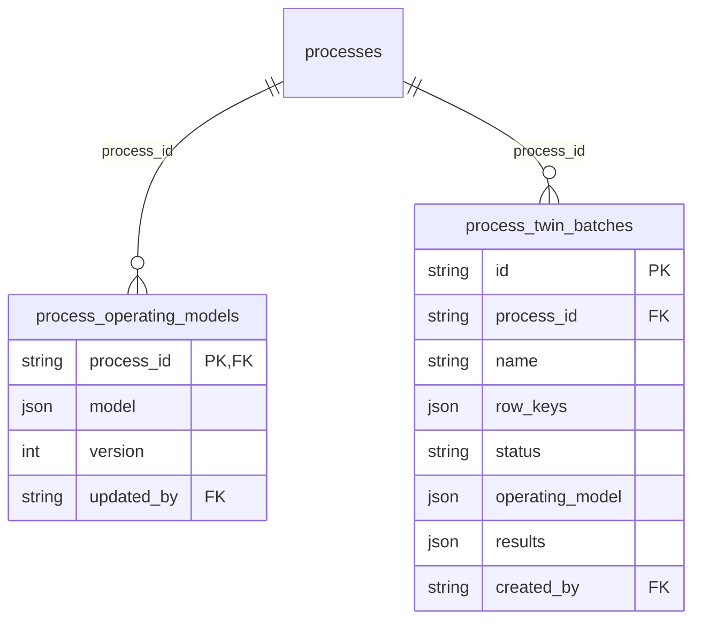
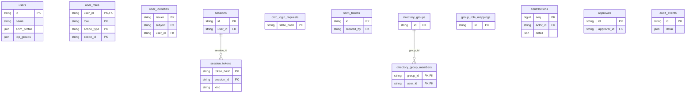
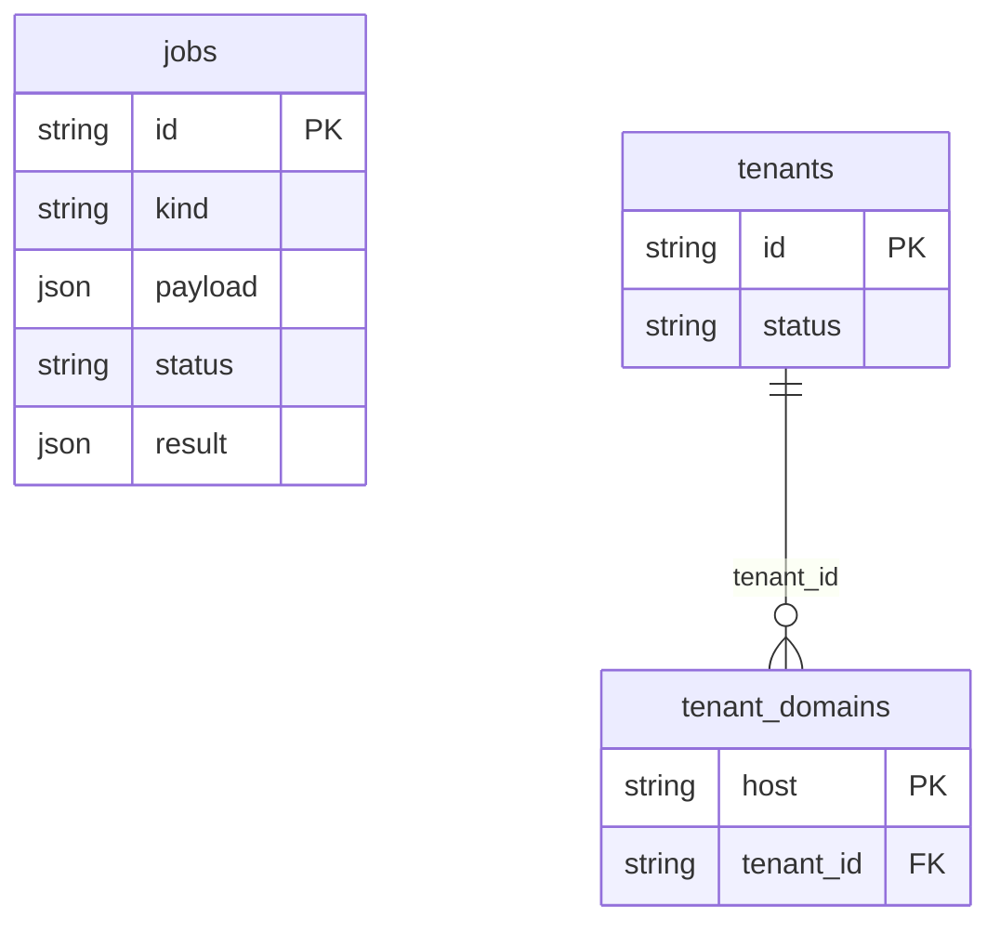

# Data Model

Last reviewed: 2026-10-15 · Sources: `backend/app/db/models.py`, `backend/migrations`

<!-- BEGIN GENERATED: schema-stats -->
**62 tables, 679 columns (90 JSON), 159 foreign keys, 34 Alembic migrations.**
<!-- END GENERATED: schema-stats -->

One PostgreSQL database holds everything: configuration, process data,
versions, agents, twin runs, organization context, datasets and results.
pgvector stores document-chunk embeddings in the same database.
Uploaded files live on the local filesystem (`DOCUMENT_STORAGE_PATH`);
the database stores their paths.

## How the data is shaped

- **One row per thing, versions as integers.** Agent artifacts,
  environments, operating models and decision rules keep a single mutable
  row and bump `version`. History comes from per-run snapshots (Epic 22)
  rather than row history. Two exceptions keep full history: finalized
  process `versions` (immutable XML) and `context_entity_versions`
  (organization rules, because compliance needs to know what applied when).
  Dataset rows also keep full history: `dataset_rows` are revisioned with
  `valid_from_version` / `valid_to_version`, so any dataset version can be
  read back.
- **JSON where the shape is owned by Pydantic.** About one column in six
  is JSON: run steps, agent definitions, scenario configuration, blueprint
  nodes, report snapshots. The Pydantic schema in `app/schemas` is the real
  contract; the database doesn't enforce it. See
  [Critical Review](Critical-Review.md) for the trade-off.
- **Runs are append-mostly.** `simulation_runs` is the unified run table
  (Epic 17). The older `twin_runs` and `orchestration_runs` are kept
  read-only for history, and reads merge all three.
- **Identity is append-only where it's evidence.** `audit_events` and
  `contributions` are never updated or deleted by the API. Tokens are
  stored only as SHA-256 hashes (`session_tokens`), never in the form a
  browser presents them. See the [Glossary](Glossary.md).
- **Every row belongs to a tenant (Epic 38).** Each table except
  `tenants` and `tenant_domains` has `tenant_id`, defaulting to the
  transaction's tenant, and a forced row-level security policy: a
  transaction sees and writes only its own tenant's rows, and one with no
  tenant sees nothing. The column is left out of the diagrams and the
  catalogue below. Uniqueness that used to be deployment-wide (user names,
  connector names, context-pack hashes, IdP identities) is per tenant.
  See the [Glossary](Glossary.md#many-customers-on-one-deployment-tenancy).
- **Everything hangs off a process.** Most tables have `process_id` with
  `ON DELETE CASCADE`, so deleting a process removes its whole tree.
  Organization context is the exception: it is organization-wide and
  scoped by business unit and jurisdiction.

## Entity-relationship diagrams

Key columns only (keys, JSON payloads, status/kind/version). Every table
also has `created_at`, and most have a `created_by` -> `users.id`; those
links are left out to keep the diagrams readable. Tables from another
domain appear as empty stubs.

<!-- BEGIN GENERATED: er-diagrams -->
### Process capture (Epics 1-6, 11)

### Blueprint and agents (Epics 7, 12-15, 20, 23)

### Digital twin runs (Epics 14, 16-22)

### Organization context (Epics 27-31)

### Ground truth and volume (Epics 32-35)

### Process twin (Epic 36)

### Identity and access (Epics 9-10, 37)

### Platform (Epics 31, 38)

<!-- END GENERATED: er-diagrams -->

## Lifecycles stored in the data

| Thing | States | Stored as |
|---|---|---|
| Document | queued -> processing -> done / failed | `documents.status` |
| Process | draft -> version pending_approval -> approved / rejected / superseded; only the latest approved version is the baseline (Epic 37) | `bpmn_drafts` + `versions.status` |
| Agent artifact | DRAFT -> SIMULATION_READY -> SIMULATING -> EVALUATED -> RELEASE_CANDIDATE -> APPROVED -> DEPLOYED | derived on read from checklist, runs, timestamps, publications |
| Simulation run | CREATED ... COMPLETED / FAILED / ESCALATED / TIMED_OUT / CANCELLED | `simulation_runs.status` |
| Context entity | proposed -> confirmed -> retired | `context_entities.status` + versions |
| Decision rule | proposed -> confirmed / unstructurable | `decision_rules.status` |
| Batch / process twin batch | running -> completed / cancelled / stopped_budget (paused in between) | `batch_runs.status`, `process_twin_batches.status` |
| Job | queued -> running -> done / failed (retried with backoff) | `jobs.status` |
| Agent approval | each high-risk change voids the approval; APPROVED once enough distinct, eligible approvers sign | `approvals` rows + `agent_artifacts.approved_through_seq` |
| User | active -> deactivated (history kept, every session revoked) | `users.active` |
| Session | live -> revoked (signed out, by user, by admin, deactivation, refresh-token reuse) or expired (idle 30 min / 12 h cap) | `sessions.revoked_at`, `last_used_at`, `expires_at` |
| Session token | issued -> rotated (kept, to detect reuse) -> deleted with its session | `session_tokens.rotated_at` |

## Table catalogue

<!-- BEGIN GENERATED: table-catalogue -->
### Process capture (Epics 1-6, 11)

#### `processes` (ProcessModel)

| Column | Type | Null | Notes |
|---|---|---|---|
| `id` | string | no | primary key |
| `name` | string | no |  |
| `created_at` | datetime | no |  |
| `updated_at` | datetime | no |  |
| `gap_analysis_completed_at` | datetime | yes |  |
| `business_unit_id` | string | yes | -> `context_entities.id` (set null) |
| `jurisdictions` | json | no |  |
| `process_type` | string | yes |  |
| `data_classes` | json | no |  |

#### `documents` (DocumentModel)

| Column | Type | Null | Notes |
|---|---|---|---|
| `id` | string | no | primary key |
| `process_id` | string | no | -> `processes.id` (cascade); indexed |
| `filename` | string | no |  |
| `content_type` | string | no |  |
| `size_bytes` | int | no |  |
| `status` | string | no |  |
| `error_message` | text | yes |  |
| `process_definition_confidence` | int | yes |  |
| `validation_message` | text | yes |  |
| `created_at` | datetime | no |  |

#### `actors` (ActorModel)

| Column | Type | Null | Notes |
|---|---|---|---|
| `id` | string | no | primary key |
| `process_id` | string | no | -> `processes.id` (cascade); indexed |
| `name` | string | no |  |
| `type` | string | no |  |

#### `process_elements` (ProcessElementModel)

| Column | Type | Null | Notes |
|---|---|---|---|
| `id` | string | no | primary key |
| `process_id` | string | no | -> `processes.id` (cascade); indexed |
| `type` | string | no |  |
| `label` | text | no |  |
| `actor_id` | string | yes | -> `actors.id` (set null) |
| `inputs` | array | no |  |
| `outputs` | array | no |  |
| `systems_touched` | array | no |  |
| `confidence` | string | no |  |

#### `source_refs` (SourceRefModel)

| Column | Type | Null | Notes |
|---|---|---|---|
| `id` | int | no | primary key |
| `element_id` | string | no | -> `process_elements.id` (cascade); indexed |
| `document_id` | string | no | -> `documents.id` (cascade) |
| `location` | string | no |  |
| `excerpt` | text | no |  |

#### `process_flows` (ProcessFlowModel)

| Column | Type | Null | Notes |
|---|---|---|---|
| `id` | string | no | primary key |
| `process_id` | string | no | -> `processes.id` (cascade); indexed |
| `from_element_id` | string | no | -> `process_elements.id` (cascade) |
| `to_element_id` | string | no | -> `process_elements.id` (cascade) |
| `condition` | text | yes |  |

#### `document_embeddings` (DocumentEmbeddingModel)

US2.3: one row per deterministic-extraction unit (a paragraph, a table, a Visio shape/connector text) -- NOT one row per document, and NOT the same grain as the LLM-structured elements above. See planning/document-ingestion-strategy.md for why embeddings are a separate, finer-grained concern from extraction.

| Column | Type | Null | Notes |
|---|---|---|---|
| `id` | int | no | primary key |
| `document_id` | string | no | -> `documents.id` (cascade); indexed |
| `location` | string | no |  |
| `content` | text | no |  |
| `embedding` | vector | no |  |

#### `process_schema_changes` (ProcessSchemaChangeModel)

US2.6: a lightweight append-only log of each merge into a process's schema -- not full event-sourcing/temporal versioning, just enough to answer "how did my understanding of this process change over time".

| Column | Type | Null | Notes |
|---|---|---|---|
| `id` | int | no | primary key |
| `process_id` | string | no | -> `processes.id` (cascade); indexed |
| `document_id` | string | yes | -> `documents.id` (set null) |
| `summary` | text | no |  |
| `created_at` | datetime | no |  |

#### `bpmn_drafts` (BPMNDraftModel)

US3.3: the current as-is BPMN diagram for a process -- one row per process (regenerating or manually editing replaces it in place; real history of prior drafts is Epic 6's finalized-versions story, not this).

| Column | Type | Null | Notes |
|---|---|---|---|
| `process_id` | string | no | primary key; -> `processes.id` (cascade) |
| `xml` | text | no |  |
| `low_confidence_element_ids` | array | no |  |
| `generated_at` | datetime | no |  |

#### `chat_messages` (ChatMessageModel)

US5.5: one row per chat turn -- the audit trail of chat-driven diagram edits (what was asked, what was proposed, whether/when it was applied or declined). `proposed_diff` stores the DiagramDiff (see app/schemas/chat.py) as JSON; null for a plain explain/clarify reply that never proposed a change.

| Column | Type | Null | Notes |
|---|---|---|---|
| `id` | string | no | primary key |
| `process_id` | string | no | -> `processes.id` (cascade); indexed |
| `request_text` | text | no |  |
| `selected_element_id` | string | yes |  |
| `kind` | string | no |  |
| `reply_text` | text | no |  |
| `proposed_diff` | json | yes |  |
| `needs_confirmation` | bool | no |  |
| `applied` | bool | no |  |
| `declined` | bool | no |  |
| `created_at` | datetime | no |  |
| `decided_at` | datetime | yes |  |

#### `versions` (VersionModel)

US6.1: an immutable snapshot of a finalized BPMN diagram -- one row per finalize, kept forever (restore reads it, never mutates it). Only the XML is snapshotted, not a copy of the process schema tables -- app/api/versions.py's restore_version is XML-only on purpose, since the draft XML can already legitimately diverge from the schema tables (a manual canvas edit via PUT /bpmn never touches them either).

| Column | Type | Null | Notes |
|---|---|---|---|
| `id` | string | no | primary key |
| `process_id` | string | no | -> `processes.id` (cascade); indexed |
| `label` | string | yes |  |
| `xml` | text | no |  |
| `created_at` | datetime | no |  |
| `created_by` | string | yes | -> `users.id` (set null) |
| `status` | string | no |  |
| `contribution_seq` | bigint | no |  |
| `decided_at` | datetime | yes |  |
| `decided_by` | string | yes | -> `users.id` (set null) |

#### `gap_findings` (GapFindingModel)

Epic 11: one row per detected process gap (structural or cross-document), and the permanent audit trail of what the user did about it -- never mutated back to "open" once resolved/dismissed, same lifecycle shape as ChatMessageModel. `options` stores the LLM-proposed resolutions as JSON (each a {label, diff} pair, `diff` shaped like DiagramDiff -- see app/schemas/chat.py -- and applied through the same apply_diagram_diff/apply_diff_and_persist path chat-ops uses, so resolving a finding is not a separate apply mechanism). "Dismiss" is not one of `options` -- it's a status a finding can always move to regardless of what the LLM proposed, handled by mark_gap_finding_dismissed rather than an option index.

| Column | Type | Null | Notes |
|---|---|---|---|
| `id` | string | no | primary key |
| `process_id` | string | no | -> `processes.id` (cascade); indexed |
| `kind` | string | no |  |
| `question` | text | no |  |
| `target_element_ids` | json | no |  |
| `options` | json | no |  |
| `status` | string | no |  |
| `chosen_option_label` | string | yes |  |
| `created_at` | datetime | no |  |
| `decided_at` | datetime | yes |  |
| `citations` | json | no |  |
| `context_pack_id` | string | yes |  |
| `decided_by` | string | yes | -> `users.id` (set null) |

### Blueprint and agents (Epics 7, 12-15, 20, 23)

#### `blueprint_overlays` (BlueprintOverlayModel)

US7.6: the agentic blueprint overlay -- one row per process, replaced in place on regenerate (mirrors BPMNDraftModel; US7.7's "re-run after baseline changes" is just calling generate again, no separate history needed here the way finalized versions need one). `nodes` stores the full list of per-node results (BlueprintNodeResult, including any nested agent_spec) as a single JSON blob rather than normalized per-node/per-agent-spec tables -- this is a generated, whole-diagram artifact that's always read and regenerated as a unit, and the only per-field mutation (override_blueprint_node) already replaces one node's dict wholesale, so normalizing would add relational complexity with no real query benefit.

| Column | Type | Null | Notes |
|---|---|---|---|
| `process_id` | string | no | primary key; -> `processes.id` (cascade) |
| `baseline_version_id` | string | no |  |
| `nodes` | json | no |  |
| `generated_at` | datetime | no |  |
| `context_pack_id` | string | yes |  |

#### `agent_artifacts` (AgentArtifactModel)

Epic 12: a generated, portable agent definition for one blueprint node or a consolidated group of nodes (US7.5's grouping). One row per distinct *group* per process, keyed by `group_key` (the group's node_ids, sorted and pipe-joined) rather than by whichever node the user happened to click "Generate" on -- clicking from any node already in a consolidated group updates the same artifact instead of creating a duplicate. `primary_node_id` is just the node the definition's content (system prompt, I/O schema) was actually built from, kept for display/linking back to a specific canvas element.

| Column | Type | Null | Notes |
|---|---|---|---|
| `id` | string | no | primary key |
| `process_id` | string | no | -> `processes.id` (cascade); indexed |
| `group_key` | string | no |  |
| `node_ids` | json | no |  |
| `primary_node_id` | string | no |  |
| `version` | int | no |  |
| `definition` | json | no |  |
| `source_baseline_version_id` | string | no |  |
| `source_node_snapshot` | json | no |  |
| `generated_at` | datetime | no |  |
| `generated_by` | string | yes | -> `users.id` (set null) |
| `marked_release_candidate_at` | datetime | yes |  |
| `approved_at` | datetime | yes |  |
| `approved_by` | string | yes | -> `users.id` (set null) |
| `approved_through_seq` | bigint | yes |  |
| `context_pack_id` | string | yes |  |
| `release_criteria` | json | yes |  |

#### `registry_entries` (RegistryEntryModel)

Epic 13: one row per agent definition pushed into the *local* reference registry connector (app/registry/local.py) -- other connector types (a real vendor registry, once one is chosen) would store entries on their own side entirely, never in this table.

| Column | Type | Null | Notes |
|---|---|---|---|
| `id` | string | no | primary key |
| `registry_name` | string | no | indexed |
| `agent_name` | string | no |  |
| `tags` | json | no |  |
| `definition` | json | no |  |
| `source_process_id` | string | yes | -> `processes.id` (set null) |
| `source_node_ids` | json | no |  |
| `pushed_at` | datetime | no |  |
| `pushed_by` | string | yes | -> `users.id` (set null) |

#### `agent_publications` (AgentPublicationModel)

Epic 15, US15.1/US15.4: one push of an agent artifact's definition to a registry -- kept forever, like VersionModel/TwinRunModel, so "republish as a new version" (US15.4) means *inserting* a new row, never mutating a prior one. `version` is deliberately not a stored column -- it's the row's 1-based rank among this artifact's publications ordered by `published_at`, computed on read the same way AgentArtifactModel's staleness is (see repository._to_pydantic_agent_publication).

| Column | Type | Null | Notes |
|---|---|---|---|
| `id` | string | no | primary key |
| `agent_artifact_id` | string | no | -> `agent_artifacts.id` (cascade); indexed |
| `registry_name` | string | no |  |
| `registry_entry_id` | string | no |  |
| `source_artifact_generated_at` | datetime | no |  |
| `status` | string | no |  |
| `published_at` | datetime | no |  |
| `published_by` | string | yes | -> `users.id` (set null) |
| `deployed_at` | datetime | yes |  |
| `deployed_by` | string | yes | -> `users.id` (set null) |

### Digital twin runs (Epics 14, 16-22)

#### `twin_tool_schemas` (TwinToolSchemaModel)

Epic 14 (core slice): the synthesized, callable schema for every `tools_systems_needed` entry of one agent artifact -- one row per artifact, replaced wholesale on regenerate (same "replace, don't version" convention as BlueprintOverlayModel/BPMNDraftModel). This resolves the gap left by Epic 12, where `tools_systems_needed` is plain strings with nothing callable behind them. `schemas` is `{system_name: {tool_name, description, parameters, response_shape_description}}` (see app/schemas/twin.py's InferredToolSchema) -- both twin system simulation modes (Proxy, Static) use this same inferred schema, only how a call's *response* is produced differs by mode.

| Column | Type | Null | Notes |
|---|---|---|---|
| `agent_artifact_id` | string | no | primary key; -> `agent_artifacts.id` (cascade) |
| `schemas` | json | no |  |
| `generated_at` | datetime | no |  |

#### `twin_baselines` (TwinBaselineModel)

Epic 14, US14.5: an optional, explicitly-manual as-is baseline for one agent artifact -- one row per artifact, replaced wholesale on update (same convention as TwinToolSchemaModel). Both value columns are nullable and independent; there is no automatic extraction of this data anywhere in the system, so its presence always means a human recorded it, never something the system inferred or fabricated.

| Column | Type | Null | Notes |
|---|---|---|---|
| `agent_artifact_id` | string | no | primary key; -> `agent_artifacts.id` (cascade) |
| `typical_time_seconds` | float | yes |  |
| `error_rate` | float | yes |  |
| `notes` | text | yes |  |
| `recorded_at` | datetime | no |  |
| `recorded_by` | string | yes | -> `users.id` (set null) |

#### `twin_environments` (TwinEnvironmentModel)

Epic 21, US21.1/US21.4: a named, versioned, reusable bundle of systems/datasets/personas/events for a process, plus its own typed fault-injection catalog per system (US21.2, `faults`). One row per environment, version bumped in place on update (see the schema's own docstring for why this doesn't keep full row history).

| Column | Type | Null | Notes |
|---|---|---|---|
| `id` | string | no | primary key |
| `process_id` | string | no | -> `processes.id` (cascade); indexed |
| `name` | string | no |  |
| `version` | int | no |  |
| `systems` | json | no |  |
| `datasets` | json | no |  |
| `personas` | json | no |  |
| `events` | json | no |  |
| `faults` | json | no |  |
| `system_data` | json | no |  |
| `created_at` | datetime | no |  |
| `created_by` | string | yes | -> `users.id` (set null) |
| `updated_at` | datetime | no |  |

#### `twin_scenarios` (TwinScenarioModel)

Epic 14 (core slice), US14.1: one defined test scenario for an agent artifact -- start-event `inputs`, per-system simulation overrides (`system_stubs`), how to resolve the agent's human checkpoint if it has one (`human_checkpoint_config`), and the expected tool-call/checkpoint path plus expected final output used to grade a run (US14.3). Epic 21, US21.3: `environment_id`/`environment_version` optionally pin this scenario to a reusable TwinEnvironmentModel whose fault catalog intercepts calls before `system_stubs` resolution -- additive and nullable, so every scenario created before this epic keeps working unchanged.

| Column | Type | Null | Notes |
|---|---|---|---|
| `id` | string | no | primary key |
| `agent_artifact_id` | string | no | -> `agent_artifacts.id` (cascade); indexed |
| `name` | string | no |  |
| `inputs` | json | no |  |
| `system_stubs` | json | no |  |
| `human_checkpoint_config` | json | no |  |
| `expected_steps` | json | no |  |
| `expected_outputs` | json | no |  |
| `environment_id` | string | yes | -> `twin_environments.id` (set null) |
| `environment_version` | int | yes |  |
| `dataset_id` | string | yes |  |
| `decision_field` | string | no |  |
| `faults` | json | no |  |
| `step_match` | string | no |  |
| `story` | json | yes |  |
| `created_at` | datetime | no |  |
| `created_by` | string | yes | -> `users.id` (set null) |

#### `twin_runs` (TwinRunModel)

Epic 14 (core slice), US14.2/US14.3/US14.4: one execution of a scenario against the real LLM (every tool/system call stubbed per the scenario's config, never live) -- kept forever, like VersionModel, since a run is evidence of what actually happened, not a value that's ever mutated in place. `agent_artifact_id` is denormalized from `scenario.agent_artifact_id` so artifact-level aggregate queries (US14.4's pass rate / cost) don't need a join through twin_scenarios.

| Column | Type | Null | Notes |
|---|---|---|---|
| `id` | string | no | primary key |
| `scenario_id` | string | no | -> `twin_scenarios.id` (cascade); indexed |
| `agent_artifact_id` | string | no | -> `agent_artifacts.id` (cascade); indexed |
| `status` | string | no |  |
| `trace` | json | no |  |
| `final_output` | json | yes |  |
| `deviations` | json | no |  |
| `total_cost_usd` | float | yes |  |
| `total_tokens` | int | no |  |
| `turns_used` | int | no |  |
| `started_at` | datetime | no |  |
| `completed_at` | datetime | no |  |
| `run_by` | string | yes | -> `users.id` (set null) |

#### `orchestration_scenarios` (OrchestrationScenarioModel)

Epic 16, US16.1: one defined process-level rehearsal scenario -- start-event inputs, plus config keyed by node_id (gateway decisions, manual-node resolution, per-node system stubs/checkpoints, per-node data-mapping mode override) needed to walk the whole blueprint's agents together. `baseline_version_id` pins the scenario to the exact finalized diagram it was authored against, same reasoning as AgentArtifactModel's `source_baseline_version_id`.

| Column | Type | Null | Notes |
|---|---|---|---|
| `id` | string | no | primary key |
| `process_id` | string | no | -> `processes.id` (cascade); indexed |
| `baseline_version_id` | string | no |  |
| `name` | string | no |  |
| `inputs` | json | no |  |
| `gateway_decisions` | json | no |  |
| `manual_node_config` | json | no |  |
| `system_stubs` | json | no |  |
| `human_checkpoint_config` | json | no |  |
| `data_mapping_mode` | json | no |  |
| `expected_path` | json | no |  |
| `expected_final_output` | json | no |  |
| `environment_id` | string | yes | -> `twin_environments.id` (set null) |
| `environment_version` | int | yes |  |
| `routing` | json | no |  |
| `created_at` | datetime | no |  |
| `created_by` | string | yes | -> `users.id` (set null) |

#### `orchestration_runs` (OrchestrationRunModel)

Epic 16, US16.2-16.7: one execution of a rehearsal scenario across every node the walk reaches. Kept forever once finished, like TwinRunModel -- but, deliberately unlike TwinRunModel, this row *is* mutated while `status == "running"` (node_runs/visited_path/etc. appended incrementally as each node completes) so the frontend can poll it for live progress (US16.7) the same way Epic 1's document processing status is polled -- see this epic's planning doc for why that's an intentional, scoped exception to the "runs are immutable evidence" convention. `process_id` is denormalized from `scenario.process_id` for the same reason TwinRunModel denormalizes `agent_artifact_id`.

| Column | Type | Null | Notes |
|---|---|---|---|
| `id` | string | no | primary key |
| `scenario_id` | string | no | -> `orchestration_scenarios.id` (cascade); indexed |
| `process_id` | string | no | -> `processes.id` (cascade); indexed |
| `status` | string | no |  |
| `node_runs` | json | no |  |
| `handoffs` | json | no |  |
| `visited_path` | json | no |  |
| `final_output` | json | yes |  |
| `deviations` | json | no |  |
| `total_cost_usd` | float | yes |  |
| `total_tokens` | int | no |  |
| `started_at` | datetime | no |  |
| `completed_at` | datetime | yes |  |
| `run_by` | string | yes | -> `users.id` (set null) |

#### `simulation_runs` (SimulationRunModel)

Epic 17: the unified run store both twin (Epic 14) and orchestration (Epic 16) runs write to going forward, replacing TwinRunModel/ OrchestrationRunModel's two separate, ad hoc shapes with one RunStatus/RunStep taxonomy (app/schemas/run.py) shared by both -- disambiguated by `kind`. Deliberately additive, not a data migration: `twin_runs`/`orchestration_runs` are left in place unaltered so no run history is lost or moved; app/db/repository.py's list/summary reads merge rows from both the old tables and this one. See planning/epics/17-simulation-run-lifecycle.md and this repo's decision-log for why.

| Column | Type | Null | Notes |
|---|---|---|---|
| `id` | string | no | primary key |
| `kind` | string | no | indexed |
| `process_id` | string | no | -> `processes.id` (cascade); indexed |
| `scenario_id` | string | no | indexed |
| `agent_artifact_id` | string | yes | -> `agent_artifacts.id` (cascade); indexed |
| `status` | string | no | indexed |
| `steps` | json | no |  |
| `node_runs` | json | no |  |
| `visited_path` | json | no |  |
| `final_output` | json | yes |  |
| `deviations` | json | no |  |
| `graded_passed` | bool | yes |  |
| `dataset_id` | string | yes | indexed |
| `dataset_version` | int | yes |  |
| `row_key` | string | yes |  |
| `trial` | int | yes |  |
| `batch_id` | string | yes | indexed |
| `seed` | bigint | yes |  |
| `evaluation` | json | yes |  |
| `total_cost_usd` | float | yes |  |
| `total_tokens` | int | no |  |
| `turns_used` | int | no |  |
| `resume_state` | json | yes |  |
| `snapshot` | json | yes |  |
| `cancel_requested` | bool | no |  |
| `queued_at` | datetime | yes |  |
| `started_at` | datetime | no |  |
| `completed_at` | datetime | yes |  |
| `run_by` | string | yes | -> `users.id` (set null) |

#### `regression_suites` (RegressionSuiteModel)

Epic 19, US19.2: a named, reusable set of scenario ids (twin or orchestration) an Automation Architect wants to re-run together as one regression pass, instead of an ungrouped scenario list. `agent_artifact_id` is required for kind="twin" (a suite of one agent's scenarios) and left null for kind="orchestration" (a process-wide rehearsal suite has no single owning artifact).

| Column | Type | Null | Notes |
|---|---|---|---|
| `id` | string | no | primary key |
| `process_id` | string | no | -> `processes.id` (cascade); indexed |
| `agent_artifact_id` | string | yes | -> `agent_artifacts.id` (cascade); indexed |
| `kind` | string | no |  |
| `name` | string | no |  |
| `scenario_ids` | json | no |  |
| `created_at` | datetime | no |  |
| `created_by` | string | yes | -> `users.id` (set null) |

#### `regression_suite_runs` (RegressionSuiteRunModel)

Epic 19, US19.3: one execution of a whole RegressionSuiteModel -- `run_ids` are SimulationRunModel ids (one per scenario, started through the existing start_twin_run/start_orchestration_run + background-task path, never a duplicated execution mechanism). Aggregate pass/fail is computed on read from those runs' own graded_passed, not stored here, the same "derive, don't duplicate" convention AgentArtifactModel's staleness already follows.

| Column | Type | Null | Notes |
|---|---|---|---|
| `id` | string | no | primary key |
| `suite_id` | string | no | -> `regression_suites.id` (cascade); indexed |
| `run_ids` | json | no |  |
| `status` | string | no |  |
| `started_at` | datetime | no |  |
| `completed_at` | datetime | yes |  |
| `started_by` | string | yes | -> `users.id` (set null) |

### Organization context (Epics 27-31)

#### `organizations` (OrganizationModel)

Epic 27, US27.1: the organization a tenant is (Epic 38: one per tenant, as row-level security shows each tenant only its own). `profile` keeps the wizard's raw answers plus which starter packs were applied at which version.

| Column | Type | Null | Notes |
|---|---|---|---|
| `id` | string | no | primary key |
| `name` | string | no |  |
| `industry` | string | yes |  |
| `size` | string | yes |  |
| `profile` | json | no |  |
| `governance` | json | no |  |
| `created_at` | datetime | no |  |
| `updated_at` | datetime | no |  |

#### `context_entities` (ContextEntityModel)

Epic 27: every organization-context entity -- business units, jurisdictions, roles, approval authorities, regulations, obligations, controls, policies, glossary terms (and Epic 29's applications/data classes) -- in one table keyed by `kind`, with kind-specific fields in `data` (validated by app/schemas/context.py). One table rather than ten because every kind shares the same lifecycle: `applies_to` scope, proposed -> confirmed confirmation, citations, source, and in-place versioning with history rows (ContextEntityVersionModel). See planning/decision-log.md (2026-10-11).

| Column | Type | Null | Notes |
|---|---|---|---|
| `id` | string | no | primary key |
| `kind` | string | no |  |
| `code` | string | yes |  |
| `name` | string | no |  |
| `data` | json | no |  |
| `applies_to` | json | no |  |
| `status` | string | no |  |
| `confidence` | float | yes |  |
| `citations` | json | no |  |
| `source` | string | no |  |
| `parent_id` | string | yes | -> `context_entities.id` (set null); indexed |
| `supersedes_id` | string | yes | -> `context_entities.id` (cascade) |
| `relaxes` | bool | no |  |
| `owner_business_unit_id` | string | yes |  |
| `external_id` | string | yes | indexed |
| `version` | int | no |  |
| `created_at` | datetime | no |  |
| `updated_at` | datetime | no |  |
| `created_by` | string | yes | -> `users.id` (set null) |
| `confirmed_by` | string | yes | -> `users.id` (set null) |
| `confirmed_at` | datetime | yes |  |

#### `context_entity_versions` (ContextEntityVersionModel)

Epic 27 Notes: history rows for ContextEntityModel. One row per version ever confirmed, holding the full entity as it was -- Epic 28's packs pin (entity_id, version) and need to read the content back.

| Column | Type | Null | Notes |
|---|---|---|---|
| `id` | string | no | primary key |
| `entity_id` | string | no | -> `context_entities.id` (cascade); indexed |
| `version` | int | no |  |
| `snapshot` | json | no |  |
| `change_note` | text | yes |  |
| `changed_at` | datetime | no |  |
| `changed_by` | string | yes | -> `users.id` (set null) |

#### `context_documents` (ContextDocumentModel)

Epic 27, US27.6: an uploaded policy document. Separate from DocumentModel, which belongs to one process -- a policy belongs to the organization.

| Column | Type | Null | Notes |
|---|---|---|---|
| `id` | string | no | primary key |
| `filename` | string | no |  |
| `content_type` | string | no |  |
| `size_bytes` | int | no |  |
| `status` | string | no |  |
| `error_message` | text | yes |  |
| `policy_entity_id` | string | yes | -> `context_entities.id` (set null) |
| `proposal_count` | int | no |  |
| `content_hash` | string | yes |  |
| `created_at` | datetime | no |  |
| `created_by` | string | yes | -> `users.id` (set null) |

#### `policy_passages` (PolicyPassageModel)

Epic 27 Notes: policy/regulation clause text in pgvector, with the scope metadata Epic 28's filtered retrieval matches against. `version` is the owning policy entity's version when the passage was written -- re-ingesting a policy writes new passages rather than mutating old ones, so a pinned pack can still cite the clause text it used.

| Column | Type | Null | Notes |
|---|---|---|---|
| `id` | string | no | primary key |
| `document_id` | string | yes | -> `context_documents.id` (cascade); indexed |
| `policy_entity_id` | string | yes | -> `context_entities.id` (cascade); indexed |
| `policy_version` | int | no |  |
| `ordinal` | int | no |  |
| `clause_ref` | string | no |  |
| `text` | text | no |  |
| `embedding` | vector | no |  |
| `applies_to` | json | no |  |
| `current` | bool | no |  |
| `created_at` | datetime | no |  |

#### `context_packs` (ContextPackModel)

Epic 28, US28.1/US28.2: one resolved, versioned Context Pack -- the exact entity versions and passages an LLM call was given. Immutable: identical content resolves to the same row (`content_hash`), so a pack id is a stable version identifier that blueprint overlays, agent artifacts, gap findings, and run snapshots can pin.

| Column | Type | Null | Notes |
|---|---|---|---|
| `id` | string | no | primary key |
| `content_hash` | string | no |  |
| `purpose` | string | no |  |
| `scope` | json | no |  |
| `process_id` | string | yes | -> `processes.id` (set null) |
| `entries` | json | no |  |
| `passages` | json | no |  |
| `token_estimate` | int | no |  |
| `budget` | int | no |  |
| `truncated` | int | no |  |
| `created_at` | datetime | no |  |

#### `process_system_links` (ProcessSystemLinkModel)

Epic 29, US29.3: which catalog application a free-text system name means within one process. One row per (process, system name) rather than an `application_id` field added to every JSON blob that holds a system string (process elements, blueprint agent specs, agent definitions): the strings stay as they are, and every consumer resolves them through this table. `auto` marks links made on an exact alias match; a person's choice is never overwritten by an auto-link.

| Column | Type | Null | Notes |
|---|---|---|---|
| `process_id` | string | no | primary key; -> `processes.id` (cascade) |
| `system_name` | string | no | primary key |
| `application_id` | string | yes | -> `context_entities.id` (cascade) |
| `auto` | bool | no |  |
| `linked_by` | string | yes | -> `users.id` (set null) |
| `linked_at` | datetime | no |  |

#### `connectors` (ConnectorModel)

Epic 31, US31.2: a configured, read-only connector to a system of record. `config` never holds a secret -- only the *name* of the environment variable that does (`token_env`).

| Column | Type | Null | Notes |
|---|---|---|---|
| `id` | string | no | primary key |
| `name` | string | no |  |
| `type` | string | no |  |
| `config` | json | no |  |
| `enabled` | bool | no |  |
| `schedule_minutes` | int | yes |  |
| `owner_business_unit_id` | string | yes |  |
| `last_sync_at` | datetime | yes |  |
| `last_status` | string | yes |  |
| `last_error` | text | yes |  |
| `created_at` | datetime | no |  |
| `created_by` | string | yes | -> `users.id` (set null) |

#### `connector_runs` (ConnectorRunModel)

| Column | Type | Null | Notes |
|---|---|---|---|
| `id` | string | no | primary key |
| `connector_id` | string | no | -> `connectors.id` (cascade); indexed |
| `status` | string | no |  |
| `stats` | json | no |  |
| `impacts` | json | no |  |
| `error` | text | yes |  |
| `started_at` | datetime | no |  |
| `finished_at` | datetime | yes |  |

#### `user_business_units` (UserBusinessUnitModel)

Epic 31, US31.7: which business units a user belongs to, and whether they steward (may confirm/edit) that unit's context. A user with no rows is unrestricted -- the single-unit default.

| Column | Type | Null | Notes |
|---|---|---|---|
| `user_id` | string | no | primary key; -> `users.id` (cascade) |
| `business_unit_id` | string | no | primary key; -> `context_entities.id` (cascade) |
| `steward` | bool | no |  |

#### `context_access_log` (ContextAccessLogModel)

Epic 31, US31.10: who and what read which context.

| Column | Type | Null | Notes |
|---|---|---|---|
| `id` | string | no | primary key |
| `at` | datetime | no | indexed |
| `actor_type` | string | no |  |
| `actor` | string | no |  |
| `action` | string | no |  |
| `process_id` | string | yes | indexed |
| `pack_id` | string | yes |  |
| `entity_ids` | json | no |  |
| `business_unit_id` | string | yes |  |
| `detail` | text | yes |  |

### Ground truth and volume (Epics 32-35)

#### `labelled_datasets` (LabelledDatasetModel)

Epic 32, US32.1: a labelled dataset -- the cases (inputs plus expected labels) a data-driven scenario is graded against, kept separate from the scenario's test logic. `version` bumps on every change to its rows (US32.6).

| Column | Type | Null | Notes |
|---|---|---|---|
| `id` | string | no | primary key |
| `process_id` | string | no | -> `processes.id` (cascade); indexed |
| `agent_artifact_id` | string | yes | -> `agent_artifacts.id` (set null); indexed |
| `name` | string | no |  |
| `description` | text | no |  |
| `version` | int | no |  |
| `created_at` | datetime | no |  |
| `updated_at` | datetime | no |  |
| `created_by` | string | yes | -> `users.id` (set null) |

#### `dataset_rows` (DatasetRowModel)

Epic 32: one revision of one case. Rows are never edited in place: a change closes the current revision (`valid_to_version`) and opens a new one, so the dataset as it was at any version can be read back exactly -- what a run pins (US32.6) and what a diff compares.

| Column | Type | Null | Notes |
|---|---|---|---|
| `id` | string | no | primary key |
| `dataset_id` | string | no | -> `labelled_datasets.id` (cascade); indexed |
| `row_key` | string | no |  |
| `valid_from_version` | int | no |  |
| `valid_to_version` | int | yes |  |
| `inputs` | json | no |  |
| `labels` | json | no |  |
| `segment` | string | no |  |
| `provenance` | string | no |  |
| `tags` | json | no |  |
| `ambiguous` | bool | no |  |
| `ambiguity_note` | text | yes |  |
| `second_labels` | json | yes |  |
| `holdout` | bool | no |  |
| `critical` | bool | no |  |
| `source_run_id` | string | yes |  |
| `confirmed_by` | string | yes | -> `users.id` (set null) |
| `confirmed_at` | datetime | yes |  |
| `created_at` | datetime | no |  |
| `created_by` | string | yes | -> `users.id` (set null) |

#### `decision_rules` (DecisionRuleModel)

Epic 33, US33.1: one gateway branch's condition as an executable rule over the process's input fields -- drafted by the LLM from the BPMN condition text, confirmed (or edited) by a person. `expression` is a small typed JSON AST (app/oracles/rules.py), never code.

| Column | Type | Null | Notes |
|---|---|---|---|
| `id` | string | no | primary key |
| `process_id` | string | no | -> `processes.id` (cascade); indexed |
| `gateway_id` | string | no |  |
| `gateway_label` | string | no |  |
| `branch_target_id` | string | no |  |
| `branch_label` | string | no |  |
| `condition_text` | text | no |  |
| `expression` | json | yes |  |
| `outcome` | string | yes |  |
| `priority` | int | no |  |
| `is_default` | bool | no |  |
| `status` | string | no |  |
| `note` | text | yes |  |
| `control_id` | string | yes |  |
| `version` | int | no |  |
| `confirmed_by` | string | yes | -> `users.id` (set null) |
| `confirmed_at` | datetime | yes |  |
| `created_at` | datetime | no |  |

#### `metamorphic_relations` (MetamorphicRelationModel)

Epic 33, US33.5: an invariant over a dataset's cases -- perturbing `field` must leave the decision unchanged (invariance) or move it in a stated direction (directional).

| Column | Type | Null | Notes |
|---|---|---|---|
| `id` | string | no | primary key |
| `dataset_id` | string | no | -> `labelled_datasets.id` (cascade); indexed |
| `name` | string | no |  |
| `kind` | string | no |  |
| `field` | string | no |  |
| `perturbation` | json | no |  |
| `direction` | string | yes |  |
| `created_at` | datetime | no |  |

#### `judge_rubrics` (JudgeRubricModel)

Epic 33, US33.6: a rubric an LLM judge grades one free-text output field against. Gate-eligible only after calibration against human verdicts reaches `min_agreement`; any change to the rubric or judge model resets that.

| Column | Type | Null | Notes |
|---|---|---|---|
| `id` | string | no | primary key |
| `process_id` | string | no | -> `processes.id` (cascade); indexed |
| `name` | string | no |  |
| `field` | string | no |  |
| `rubric` | text | no |  |
| `judge_model` | string | yes |  |
| `version` | int | no |  |
| `min_agreement` | float | no |  |
| `min_samples` | int | no |  |
| `calibration` | json | yes |  |
| `created_at` | datetime | no |  |

#### `batch_runs` (BatchRunModel)

Epic 34, US34.2: one execution of a data-driven scenario over a dataset version -- rows x trials runs, executed through the job queue (correctness mode) or by an in-process load driver (load mode).

| Column | Type | Null | Notes |
|---|---|---|---|
| `id` | string | no | primary key |
| `process_id` | string | no | -> `processes.id` (cascade); indexed |
| `scenario_id` | string | no | indexed |
| `agent_artifact_id` | string | no | indexed |
| `agent_version` | int | no |  |
| `dataset_id` | string | no |  |
| `dataset_version` | int | no |  |
| `mode` | string | no |  |
| `tier` | string | no |  |
| `trials` | int | no |  |
| `sample` | json | no |  |
| `row_keys` | json | no |  |
| `status` | string | no |  |
| `budget_usd` | float | yes |  |
| `estimate` | json | no |  |
| `load_settings` | json | no |  |
| `keep_traces` | string | no |  |
| `schedule_id` | string | yes |  |
| `created_by` | string | yes | -> `users.id` (set null) |
| `created_at` | datetime | no |  |
| `finished_at` | datetime | yes |  |

#### `batch_schedules` (BatchScheduleModel)

Epic 34, US34.9: run a tier of a data-driven scenario on a schedule, and/or whenever its dataset or the agent's pinned context changes.

| Column | Type | Null | Notes |
|---|---|---|---|
| `id` | string | no | primary key |
| `process_id` | string | no | -> `processes.id` (cascade); indexed |
| `scenario_id` | string | no |  |
| `tier` | string | no |  |
| `trials` | int | no |  |
| `every_minutes` | int | yes |  |
| `on_dataset_change` | bool | no |  |
| `on_context_change` | bool | no |  |
| `budget_usd` | float | yes |  |
| `enabled` | bool | no |  |
| `last_run_at` | datetime | yes |  |
| `last_dataset_version` | int | yes |  |
| `last_context_pack_id` | string | yes |  |
| `created_at` | datetime | no |  |

### Process twin (Epic 36)

#### `process_operating_models` (ProcessOperatingModel)

Epic 36, US36.4: how a process runs today -- per node, who does it, how long it takes and waits, what that time costs; per process, how many cases arrive. The as-is side of every process twin comparison. One row per process, `version` bumped on save; a process twin batch snapshots the model it ran with.

| Column | Type | Null | Notes |
|---|---|---|---|
| `process_id` | string | no | primary key; -> `processes.id` (cascade) |
| `model` | json | no |  |
| `version` | int | no |  |
| `updated_by` | string | yes | -> `users.id` (set null) |
| `updated_at` | datetime | no |  |

#### `process_twin_batches` (ProcessTwinBatchModel)

Epic 36, US36.5: the whole process run as a digital twin over a dataset -- one orchestration run per case (SimulationRunModel rows with `batch_id` = this id), executed through the job queue. `results` is the efficiency report (US36.7), computed once the last case finishes.

| Column | Type | Null | Notes |
|---|---|---|---|
| `id` | string | no | primary key |
| `process_id` | string | no | -> `processes.id` (cascade); indexed |
| `name` | string | no |  |
| `scenario_id` | string | no |  |
| `dataset_id` | string | no |  |
| `dataset_version` | int | no |  |
| `row_keys` | json | no |  |
| `status` | string | no |  |
| `budget_usd` | float | yes |  |
| `seed` | int | no |  |
| `operating_model` | json | no |  |
| `operating_model_version` | int | no |  |
| `results` | json | yes |  |
| `created_by` | string | yes | -> `users.id` (set null) |
| `created_at` | datetime | no |  |
| `finished_at` | datetime | yes |  |

### Identity and access (Epics 9-10, 37)

#### `users` (UserModel)

Epic 9/10, US9.9/US10.4: a named user. In AUTH_MODE=local (Epic 37, US37.14: never in production) "log in" means typing a name and picking roles; SSO (US37.7+) will only change how rows get here. What a user may do is their UserRoleModel grants, not a column on this table (US37.1).

| Column | Type | Null | Notes |
|---|---|---|---|
| `id` | string | no | primary key |
| `name` | string | no |  |
| `actor_type` | string | no |  |
| `active` | bool | no |  |
| `created_at` | datetime | no |  |
| `provisioned_by` | string | no |  |
| `email` | string | yes |  |
| `scim_user_name` | string | yes | indexed |
| `scim_external_id` | string | yes | indexed |
| `scim_profile` | json | yes |  |
| `scim_deleted_at` | datetime | yes |  |
| `idp_groups` | json | yes |  |

#### `user_roles` (UserRoleModel)

Epic 37, US37.1: one role grant at one scope. `scope_type` is `organization` (scope_id "") or `business_unit` (a context entity id). A `process` scope is deliberately left open: permission checks walk a process's scope chain (app/auth/permissions.py), so adding it means accepting one more value here, not changing any route guard.

| Column | Type | Null | Notes |
|---|---|---|---|
| `user_id` | string | no | primary key; -> `users.id` (cascade) |
| `role` | string | no | primary key |
| `scope_type` | string | no | primary key |
| `scope_id` | string | no | primary key |
| `source` | string | no |  |
| `granted_at` | datetime | no |  |
| `granted_by` | string | yes |  |

#### `user_identities` (UserIdentityModel)

Epic 37, US37.7: a user's account at an identity provider. A user is matched by (issuer, subject) -- the IdP's stable, never-reassigned id -- never by email or name, which change and get reused. `email` and `username` are kept for display and the audit trail only.

| Column | Type | Null | Notes |
|---|---|---|---|
| `issuer` | string | no | primary key |
| `subject` | string | no | primary key |
| `user_id` | string | no | -> `users.id` (cascade); indexed |
| `email` | string | yes |  |
| `username` | string | yes |  |
| `created_at` | datetime | no |  |
| `last_sign_in_at` | datetime | yes |  |

#### `sessions` (SessionModel)

Epic 37, US37.12: one sign-in on one browser. `id` isn't a secret -- it's what the Sessions lists show and revoke by. The browser holds tokens for it instead (SessionTokenModel), stored only as hashes.

| Column | Type | Null | Notes |
|---|---|---|---|
| `id` | string | no | primary key |
| `user_id` | string | no | -> `users.id` (cascade); indexed |
| `created_at` | datetime | no |  |
| `last_used_at` | datetime | no |  |
| `expires_at` | datetime | no |  |
| `revoked_at` | datetime | yes |  |
| `revoked_reason` | string | yes |  |
| `csrf_token` | string | no |  |
| `ip` | string | yes |  |
| `user_agent` | string | yes |  |
| `auth_method` | string | no |  |
| `idp_issuer` | string | yes |  |
| `idp_subject` | string | yes |  |
| `idp_sid` | string | yes | indexed |
| `idp_id_token` | text | yes |  |
| `idp_refresh_token` | text | yes |  |

#### `session_tokens` (SessionTokenModel)

Epic 37, US37.12: a token the browser holds for a session -- a short-lived `access` token (the session cookie) or a `refresh` token (the refresh cookie). Only the SHA-256 hash is stored. A refreshed token is kept with `rotated_at` set, rather than deleted, so a second use of it can be recognized as theft (app/auth/sessions.py).

| Column | Type | Null | Notes |
|---|---|---|---|
| `token_hash` | string | no | primary key |
| `session_id` | string | no | -> `sessions.id` (cascade); indexed |
| `kind` | string | no |  |
| `issued_at` | datetime | no |  |
| `expires_at` | datetime | no |  |
| `rotated_at` | datetime | yes |  |

#### `oidc_login_requests` (OidcLoginRequestModel)

Epic 37, US37.7: one sign-in in flight, between sending the browser to the IdP and its return to the callback. Keyed by the hash of `state`; holds the PKCE verifier and nonce the callback must check. Used once, then deleted; abandoned ones expire after ten minutes.

| Column | Type | Null | Notes |
|---|---|---|---|
| `state_hash` | string | no | primary key |
| `nonce` | string | no |  |
| `code_verifier` | string | no |  |
| `return_to` | string | no |  |
| `created_at` | datetime | no |  |

#### `scim_tokens` (ScimTokenModel)

Epic 37, US37.10: a bearer token the IdP's provisioning uses. Shown once when generated, stored only as a SHA-256 hash. Several can be live at once so a rotation doesn't interrupt provisioning: generate a new one, switch the IdP over, revoke the old one.

| Column | Type | Null | Notes |
|---|---|---|---|
| `id` | string | no | primary key |
| `token_hash` | string | no |  |
| `label` | string | no |  |
| `created_at` | datetime | no |  |
| `created_by` | string | yes | -> `users.id` (set null) |
| `last_used_at` | datetime | yes |  |
| `revoked_at` | datetime | yes |  |

#### `directory_groups` (DirectoryGroupModel)

Epic 37, US37.10: a group the IdP pushed over SCIM. Its display name and external id are what group mappings match on.

| Column | Type | Null | Notes |
|---|---|---|---|
| `id` | string | no | primary key |
| `display_name` | string | no |  |
| `external_id` | string | yes | indexed |
| `created_at` | datetime | no |  |
| `updated_at` | datetime | no |  |

#### `directory_group_members` (DirectoryGroupMemberModel)

| Column | Type | Null | Notes |
|---|---|---|---|
| `group_id` | string | no | primary key; -> `directory_groups.id` (cascade) |
| `user_id` | string | no | primary key; -> `users.id` (cascade); indexed |

#### `group_role_mappings` (GroupRoleMappingModel)

Epic 37, US37.11: members of a group hold a role at a scope (the same scope_type/scope_id as UserRoleModel). The group is matched, ignoring case, against a SCIM group's display name or external id, or a value in the SSO groups claim (a name for Keycloak and Okta, an object id for Entra ID). Grants made this way are UserRoleModel rows with source "group", recomputed whenever groups or mappings change.

| Column | Type | Null | Notes |
|---|---|---|---|
| `id` | string | no | primary key |
| `group` | string | no | indexed |
| `role` | string | no |  |
| `scope_type` | string | no |  |
| `scope_id` | string | no |  |
| `created_at` | datetime | no |  |
| `created_by` | string | yes |  |

#### `contributions` (ContributionModel)

Epic 37, US37.3: who changed a process or an agent, how, and at what risk tier. `seq` orders contributions globally; a change set awaiting approval is "this object's contributions after the last approved one" (app/auth/sod.py), which is what decides who may approve it.

| Column | Type | Null | Notes |
|---|---|---|---|
| `seq` | bigint | no | primary key |
| `object_type` | string | no |  |
| `object_id` | string | no |  |
| `process_id` | string | yes | indexed |
| `actor_type` | string | no |  |
| `actor_id` | string | yes | -> `users.id` (set null) |
| `action` | string | no |  |
| `tier` | string | no |  |
| `at` | datetime | no |  |
| `detail` | json | no |  |

#### `approvals` (ApprovalModel)

Epic 37, US37.4/US37.5: one approver's decision on one change set. `through_seq` is the object's last high-risk contribution when the decision was made, so a later high-risk change makes it count for nothing without deleting it (the audit keeps it).

| Column | Type | Null | Notes |
|---|---|---|---|
| `id` | string | no | primary key |
| `object_type` | string | no |  |
| `object_id` | string | no | indexed |
| `process_id` | string | yes | indexed |
| `through_seq` | bigint | no |  |
| `approver_id` | string | yes | -> `users.id` (set null) |
| `decision` | string | no |  |
| `comment` | text | yes |  |
| `at` | datetime | no |  |

#### `audit_events` (AuditEventModel)

Epic 37, US37.6: append-only record of sign-ins, privileged writes, approvals and refusals. No API updates or deletes it. `actor_name` is copied in so the trail still reads correctly if a user is renamed.

| Column | Type | Null | Notes |
|---|---|---|---|
| `id` | string | no | primary key |
| `at` | datetime | no | indexed |
| `actor_type` | string | no |  |
| `actor_id` | string | yes | indexed |
| `actor_name` | string | yes |  |
| `action` | string | no | indexed |
| `object_type` | string | yes |  |
| `object_id` | string | yes |  |
| `process_id` | string | yes | indexed |
| `outcome` | string | no |  |
| `ip` | string | yes |  |
| `user_agent` | string | yes |  |
| `detail` | json | no |  |

### Platform (Epics 31, 38)

#### `jobs` (JobModel)

Epic 31, US31.1: a durable background job -- Postgres-backed so it survives restarts and needs no extra infrastructure. Workers claim jobs with SELECT ... FOR UPDATE SKIP LOCKED (app/jobs/queue.py).

| Column | Type | Null | Notes |
|---|---|---|---|
| `id` | string | no | primary key |
| `kind` | string | no | indexed |
| `payload` | json | no |  |
| `status` | string | no |  |
| `priority` | int | no |  |
| `attempts` | int | no |  |
| `max_attempts` | int | no |  |
| `run_after` | datetime | no |  |
| `locked_by` | string | yes |  |
| `locked_at` | datetime | yes |  |
| `last_error` | text | yes |  |
| `result` | json | yes |  |
| `dedupe_key` | string | yes | indexed |
| `created_at` | datetime | no |  |
| `finished_at` | datetime | yes |  |

#### `tenants` (TenantModel)

Epic 38, US38.1: one customer of this deployment. Every other table is the tenant's own (TenantScoped).

| Column | Type | Null | Notes |
|---|---|---|---|
| `id` | string | no | primary key |
| `slug` | string | no |  |
| `display_name` | string | no |  |
| `status` | string | no |  |
| `region` | string | yes |  |
| `created_at` | datetime | no |  |

#### `tenant_domains` (TenantDomainModel)

Epic 38, US38.1: a host name that reaches a tenant, matched without the port (`meridian.localhost`, `acme.axyntro.app`, a custom domain).

| Column | Type | Null | Notes |
|---|---|---|---|
| `host` | string | no | primary key |
| `tenant_id` | string | no | -> `tenants.id` (cascade); indexed |
| `created_at` | datetime | no |  |
<!-- END GENERATED: table-catalogue -->
