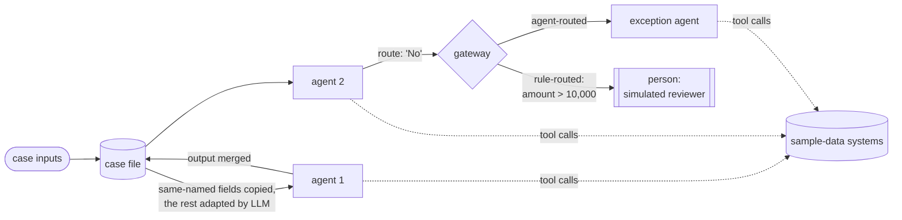

# The process digital twin (Epic 36)

Last reviewed: 2026-10-15 · Sources: `backend/app/process_twin`, `backend/app/twin/orchestrator.py`, `backend/app/twin/records.py`, `planning/epics/36-process-twin-efficiency.md`

The process twin runs the **whole** agentic process (every generated
agent, the people still in the loop, every decision point) over hundreds
of realistic cases before anything reaches production. It then compares
the result with how the process runs today. Stories and acceptance
criteria are in [Epic 36](../../planning/epics/36-process-twin-efficiency.md);
the worked demo is in `demo-deck/process-twin/`.

## The four ingredients

| Ingredient | What it is | Where |
|---|---|---|
| **Agents** | One generated agent per automatable step (Epic 12), simulation-ready (Epic 23) | Blueprint -> Agents |
| **A world** | Simulated systems answering from sample records: vendor master, purchase orders, ledger, and so on. Deterministic, no LLM call | Twin environment `system_data` |
| **Cases** | A labelled dataset: the inputs plus the right outcome (Epic 32) | Golden cases |
| **Today's baseline** | Who does each step, how long it takes and waits, what it costs, monthly volume | Process twin -> operating model |

## How one case runs

- **Case file (US36.2).** The start inputs plus every step's output so
  far. Each agent's declared inputs are built from it: fields with matching
  names are copied for free, and the LLM adapter is used only for missing
  ones (it maps to null rather than invent a value). The agent also gets
  the rest of the case file under `case_file`, because blueprint-generated
  input names are often loose ("Invoice Document") and an agent needs, for
  example, the document reference to look anything up.
- **Gateways (US36.3).** Choose per gateway:
  - `agent`: the agent before the gateway picks a branch label, for
    judgement calls.
  - `rules`: confirmed Epic 33 rules evaluated on the case file, for
    policy thresholds.
  - `configured`: a fixed branch, Epic 16's original behaviour.
  The DECISION step records which mode decided and why.
- **People.** Manual steps and agents' review requests are answered by
  seeded simulated reviewers, so a case replays exactly.

## How savings are computed

For every case, each task on the path the case took is costed twice:

| | As-is (today) | To-be (with agents) |
|---|---|---|
| Agent step | wait + a person's handling time | agent's measured time; plus reviewer wait + review time when it asks |
| Manual step | wait + handling | to-be wait + the same handling |
| Case the twin couldn't finish | -- | counted as fully manual, on top of what the twin spent |

Times come from the operating model's triangular distributions, with the
same random draws for both sides of a case (a paired comparison). The
report gives:

- straight-through rate and outcome accuracy, with Wilson intervals
- cycle-time and people-time reduction, with paired bootstrap intervals
- cost per case (labour plus AI)
- annualised hours, FTE and cost released at the stated volume
- per-step failures, review rate and AI cost
- results by kind of case
- the expected-vs-actual outcome matrix and the routes cases took

Everything the extrapolation assumes is listed under "How these numbers
are worked out".

## Limits

These are listed in Epic 36's notes and the [Critical Review](Critical-Review.md):

- No parallel gateways.
- Waits are sampled, not simulated from arrivals and capacity (US36.9).
- Sample-data writes don't trigger downstream system behaviour.
- The as-is comparison follows the twin's path, so it's approximate for
  misrouted cases.
