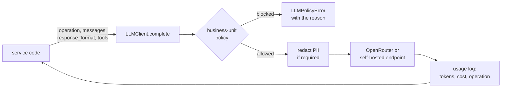

# Prompts and LLM use

Last reviewed: 2026-10-13 · Sources: `backend/app/llm`, `backend/app/blueprint/prompts.py`, `backend/app/chat/prompts.py`, `backend/app/gap_analysis/prompts.py`

## How model calls are made

Every call goes through one client, `LLMClient.complete`
(`backend/app/llm/client.py`), an OpenAI-compatible SDK client pointed at
OpenRouter by default (`LLM_MODEL=qwen/qwen3.7-flash`, chosen for cost; see
`planning/claude-api-access-notes.md`). The client:

1. **Applies the business unit's model policy** (`llm/routing.py`). A
   process in a unit that requires EU hosting, a particular provider, or
   a self-hosted endpoint is routed there, or the call is refused with the
   reason. PII is redacted first when the policy says so.
2. **Retries** transient failures (`LLM_MAX_RETRIES`) with a timeout
   (`LLM_REQUEST_TIMEOUT_SECONDS`).
3. **Throttles** to `LLM_MAX_CONCURRENCY` concurrent requests and marks
   stable prefixes for **prompt caching** (Epic 34).
4. **Accounts** tokens and estimated cost per `operation` into the usage
   log (`llm/usage.py`). This is how every run, batch and process twin
   reports its cost.

Callers ask for JSON (`response_format={"type": "json_object"}`) wherever
they parse the reply. The reply is validated with Pydantic, and malformed
output becomes a domain error, never data. Agent runs in the twin are the
exception: they use tool calling, and their final answer is parsed as JSON
(a stray ```` ```json ```` fence is tolerated).



## Where prompts come from

There are three styles, and the catalogue below shows each one's source:

- **Prompt modules** (`blueprint/prompts.py`, `chat/prompts.py`,
  `gap_analysis/prompts.py`): a system prompt with the rubric and the JSON
  schema to return, plus a builder that renders the process and the
  organization's **context pack** (Epic 28: applicable rules, roles,
  approval authority, applications, each citable by id) into the user
  message.
- **Inline prompts** in the service that makes the call, for short,
  single-purpose calls (rule structuring, data adapter, system
  simulation, tool-schema inference).
- **Agent system prompts**, generated deterministically from the
  blueprint's agent spec (`agents/generation.py`). The twin never modifies
  them; it appends a separate, run-only instruction message
  (`twin/engine.py` `_twin_instructions`). That message covers which tool
  is which system, how to ask for review, the exact output keys, and, for
  an agent-routed gateway (Epic 36), the branch labels to choose from in
  `route`.

## Catalogue of every model call

Generated from the code: each call site of `LLMClient.complete`, its
operation name, and the source of the function that builds the prompt
plus any prompt helpers or constants it uses.

<!-- BEGIN GENERATED: prompt-catalogue -->
| Operation | Purpose | Where | Output | Tools | Max tokens |
|---|---|---|---|---|---|
| `blueprint_evaluation` | Judge every step of a finalized process for agent automation and specify the agent | `backend/app/blueprint/service.py` `_evaluate_chunk_once()` | JSON | no | 16000 |
| `chat_edit` | Turn a chat instruction into a diagram change (add/amend/delete a node or flow) | `backend/app/chat/service.py` `handle_chat_message()` | JSON | no | 16000 |
| `document_extraction` | Extract the process (actors, steps, decisions, flows) from a document or image | `backend/app/ingestion/structuring.py` `_classify_process_definition()` | JSON | no | 2000 |
| `document_extraction` | Extract the process (actors, steps, decisions, flows) from a document or image | `backend/app/ingestion/structuring.py` `_complete_and_parse()` | JSON | no | 16000 |
| `gap_analysis` | Find gaps and ambiguities in an extracted process before diagramming | `backend/app/gap_analysis/service.py` `analyze_gaps()` | JSON | no | 16000 |
| `oracle_judge` | Grade a free-text output against a calibrated rubric (LLM judge) | `backend/app/oracles/service.py` `judge()` | JSON | no | 4000 |
| `oracle_rule_structuring` | Turn a gateway's condition text into an executable rule expression | `backend/app/oracles/service.py` `propose_rules()` | JSON | no | 8000 |
| `orchestration_data_adapter` | Reshape the case file into the next agent's input fields | `backend/app/twin/orchestrator.py` `_adapt_data()` | JSON | no | 8000 |
| `policy_extraction` | Extract obligations, controls and approval rules from an uploaded policy document | `backend/app/context/ingestion.py` `extract_proposals()` | JSON | no | 16000 |
| `twin_builder_describe` | Turn a plain-language description into a test situation | `backend/app/twin/test_builder.py` `describe_situation()` | JSON | no | default |
| `twin_builder_personas` | Cast reviewer personas for a test | `backend/app/twin/test_builder.py` `generate_personas()` | JSON | no | default |
| `twin_builder_suggest` | Draft test situations from the blueprint (guided test builder) | `backend/app/twin/test_builder.py` `suggest_situations()` | JSON | no | default |
| `twin_run` | The agent itself, running in the twin with tools and the review tool | `backend/app/twin/engine.py` `run_scenario()` | JSON | yes | default |
| `twin_system_simulation` | Play a system (Proxy mode) and fabricate a plausible response | `backend/app/twin/simulators.py` `_fabricate_proxy_response()` | JSON | no | 8000 |
| `twin_tool_schema_inference` | Invent a callable tool schema for each system an agent needs | `backend/app/twin/schema_inference.py` `infer_tool_schemas()` | JSON | no | 16000 |

**15 call sites, 14 operations.** Every call goes through `LLMClient.complete` (`backend/app/llm/client.py`), which applies the business unit's model policy (residency, PII redaction, provider allow-list) and logs usage and cost per operation.

### `blueprint_evaluation`

Judge every step of a finalized process for agent automation and specify the agent

<details>
<summary><code>backend/app/blueprint/service.py -- _evaluate_chunk_once()</code></summary>

```python
async def _evaluate_chunk_once(
    llm: LLMClient, chunk: list[FlowNodeInfo], flow_nodes: list[FlowNodeInfo], context_text: str
) -> list[BlueprintNodeResult]:
    rest = [n for n in flow_nodes if n not in chunk]
    system_prompt = build_system_prompt(chunk, context_text, context_nodes=rest or None)

    result = await llm.complete(
        [ChatMessage(role="system", content=system_prompt)],
        operation="blueprint_evaluation",
        response_format={"type": "json_object"},
        # Same headroom as chat_edit/document_extraction -- Qwen3.7 Flash
        # spends part of this budget on internal reasoning, and a full
        # diagram's worth of nodes each needing a rationale + agent spec is
        # a large JSON payload.
        max_tokens=16000,
    )

    if not result.text:
        raise BlueprintServiceError("LLM returned no content while evaluating the blueprint")
    if result.finish_reason == "length":
        raise BlueprintServiceError(
            f"The blueprint for {len(chunk)} steps was cut off at the output limit -- lower CHUNK_SIZE in "
            "app/blueprint/service.py"
        )

    try:
        payload: Any = json.loads(result.text)
        parsed = _ParsedOverlay.model_validate(payload)
    except (json.JSONDecodeError, ValidationError) as exc:
        raise _MalformedReply(f"LLM returned invalid structured output for the blueprint: {exc}") from exc

    chunk_ids = {node.id for node in chunk}
    results = [r for r in parsed.nodes if r.node_id in chunk_ids]
    for r in results:
        # Consolidation can't reach outside the chunk the model evaluated.
        if r.agent_spec is not None and r.agent_spec.consolidated_from_nodes:
            r.agent_spec.consolidated_from_nodes = [n for n in r.agent_spec.consolidated_from_nodes if n in chunk_ids]
    return results
```

</details>

<details>
<summary><code>backend/app/blueprint/prompts.py -- build_system_prompt</code></summary>

```python
def build_system_prompt(
    nodes: list[FlowNodeInfo], context_text: str = "", context_nodes: list[FlowNodeInfo] | None = None
) -> str:
    """Epic 28, US28.5: `context_text` is a rendered Context Pack
    (app/context/resolver.py's render_pack); empty when no organization
    context applies, which leaves the prompt as it was before Epic 28.

    `context_nodes`: the rest of the diagram when only `nodes` are being
    evaluated in this call (a large diagram is evaluated in chunks, see
    app/blueprint/service.py), so the model still sees the whole process."""
    nodes_json = json.dumps([_node_context(n) for n in nodes], indent=2)
    if context_nodes:
        nodes_json += _REST_OF_DIAGRAM + json.dumps(
            [{"id": n.id, "label": n.label, "bpmn_type": n.bpmn_type, "actor_or_lane": n.lane_name} for n in context_nodes]
        )
    prompt = _INSTRUCTIONS.replace("##NODES_JSON##", nodes_json)
    if not context_text:
        return prompt.replace("##CONTEXT_RULES##", "").replace("##APPLICABLE_RULES_FIELD##", "")
    prompt = prompt.replace("##APPLICABLE_RULES_FIELD##", _APPLICABLE_RULES_FIELD)
    return prompt.replace("##CONTEXT_RULES##", _CONTEXT_RULES) + "\n" + context_text + "\n"
```

</details>

### `chat_edit`

Turn a chat instruction into a diagram change (add/amend/delete a node or flow)

<details>
<summary><code>backend/app/chat/service.py -- handle_chat_message()</code></summary>

```python
async def handle_chat_message(
    llm: LLMClient,
    *,
    schema: ProcessSchema,
    history: list[ChatMessageResult],
    selected_element_id: str | None,
    text: str,
    context_text: str = "",
) -> ParsedChatReply:
    selected_label = _element_label(schema, selected_element_id) if selected_element_id else None
    system_prompt = build_system_prompt(schema, selected_label, context_text)

    messages = [
        ChatMessage(role="system", content=system_prompt),
        *_build_history_messages(history),
        ChatMessage(role="user", content=text),
    ]

    result = await llm.complete(
        messages,
        operation="chat_edit",
        response_format={"type": "json_object"},
        # Same headroom as app/ingestion/structuring.py, and for the same
        # reason -- Qwen3.7 Flash spends part of this budget on internal
        # reasoning before the visible JSON reply; confirmed hitting a
        # smaller (4000) cap with finish_reason="length" and empty
        # result.text on a real chat_edit call during manual testing.
        max_tokens=16000,
    )

    if not result.text:
        raise ChatServiceError("LLM returned no content for chat message")

    try:
        payload: Any = json.loads(result.text)
        parsed = _ParsedReply.model_validate(payload)
    except (json.JSONDecodeError, ValidationError) as exc:
        raise ChatServiceError(f"LLM returned invalid structured output for chat message: {exc}") from exc

    diff = _translate_diff_ids(schema, parsed.diff) if parsed.kind == "edit" and parsed.diff is not None else None
    if parsed.kind == "edit" and diff is None:
        raise ChatServiceError("LLM classified the message as an edit but returned no diff")

    return ParsedChatReply(
        kind=parsed.kind,
        reply_text=parsed.reply_text,
        diff=diff,
        needs_confirmation=parsed.kind == "edit",
    )
```

</details>

<details>
<summary><code>backend/app/chat/service.py -- _build_history_messages</code></summary>

```python
def _build_history_messages(history: list[ChatMessageResult]) -> list[ChatMessage]:
    messages: list[ChatMessage] = []
    for past in history[-_HISTORY_TURNS:]:
        messages.append(ChatMessage(role="user", content=past.request_text))
        messages.append(ChatMessage(role="assistant", content=past.reply_text))
    return messages
```

</details>

<details>
<summary><code>backend/app/chat/prompts.py -- build_system_prompt</code></summary>

```python
def build_system_prompt(
    schema: ProcessSchema, selected_element_label: str | None, context_text: str = ""
) -> str:
    """Uses plain placeholder tokens + str.replace rather than str.format --
    the instructions text is full of literal JSON braces (the response
    shape example) that would otherwise all need escaping.

    Epic 28, US28.7: `context_text` is a vocabulary-only Context Pack (the
    glossary terms and application names the message mentions), appended
    so "the onboarding system" resolves to the organization's own name."""
    schema_json = json.dumps(schema.model_dump(by_alias=True), indent=2)
    selected_context = (
        f'\nThe user currently has "{selected_element_label}" selected on the canvas -- '
        "prefer that element for an ambiguous reference like \"this step\" unless the message "
        "clearly names something else."
        if selected_element_label
        else ""
    )
    schema_contract = _SCHEMA_CONTEXT.replace("##SCHEMA_JSON##", schema_json).replace(
        "##SELECTED_CONTEXT##", selected_context
    )
    prompt = _INSTRUCTIONS.replace("##SCHEMA_CONTRACT##", schema_contract)
    if context_text:
        prompt += (
            "\n\n" + context_text + "\nUse the organization's own names for systems and terms above when "
            "adding or renaming steps."
        )
    return prompt
```

</details>

### `document_extraction`

Extract the process (actors, steps, decisions, flows) from a document or image

<details>
<summary><code>backend/app/ingestion/structuring.py -- _classify_process_definition()</code></summary>

```python
async def _classify_process_definition(
    llm: LLMClient, *, filename: str, content: str | list[ContentBlock]
) -> _ClassificationResult | None:
    """Best-effort fallback used only when the main extraction call omits
    the classification fields. Never raises -- any failure here just means
    the caller keeps waiting for a definitive answer (or, after exhausting
    attempts, falls back to the existing fail-closed default), the same as
    if the model had omitted the fields again."""
    try:
        result = await llm.complete(
            [ChatMessage(role="user", content=_with_classification_followup(content))],
            operation="document_extraction",
            response_format={"type": "json_object"},
            max_tokens=2000,
        )
        if not result.text:
            return None
        return _ClassificationResult.model_validate(json.loads(result.text))
    except (json.JSONDecodeError, ValidationError):
        return None
```

</details>

### `document_extraction`

Extract the process (actors, steps, decisions, flows) from a document or image

<details>
<summary><code>backend/app/ingestion/structuring.py -- _complete_and_parse()</code></summary>

```python
async def _complete_and_parse(llm: LLMClient, *, filename: str, content: str | list[ContentBlock]) -> _ExtractedSchema:
    result = await llm.complete(
        [ChatMessage(role="user", content=content)],
        operation="document_extraction",
        response_format={"type": "json_object"},
        # Qwen3.7 Flash spends part of this budget on internal reasoning
        # before the visible answer (observed even on trivial prompts) --
        # 8000 was measured hitting the cap on a real, moderately-sized
        # document with output_tokens=8000 and empty result.text. 16000
        # leaves headroom for reasoning + a sizable process JSON.
        max_tokens=16000,
    )

    if not result.text:
        if result.finish_reason == "length":
            raise StructuringError(
                f"LLM response for '{filename}' was truncated at the token limit before producing "
                "an answer (likely spent on internal reasoning) -- try a shorter/simpler document"
            )
        raise StructuringError(f"LLM returned no content while structuring '{filename}'")

    try:
        payload: Any = json.loads(result.text)
        return _ExtractedSchema.model_validate(payload)
    except (json.JSONDecodeError, ValidationError) as exc:
        raise StructuringError(f"LLM returned invalid structured output for '{filename}': {exc}") from exc
```

</details>

### `gap_analysis`

Find gaps and ambiguities in an extracted process before diagramming

<details>
<summary><code>backend/app/gap_analysis/service.py -- analyze_gaps()</code></summary>

```python
async def analyze_gaps(
    llm: LLMClient, schema: ProcessSchema, context_pack: ContextPackModel | None = None
) -> list[_ProposedFinding]:
    if not schema.elements:
        return []

    system_prompt = build_system_prompt(schema, render_pack(context_pack) if context_pack is not None else "")
    result = await llm.complete(
        [ChatMessage(role="system", content=system_prompt)],
        operation="gap_analysis",
        response_format={"type": "json_object"},
        # Same headroom as blueprint_evaluation/document_extraction --
        # Qwen3.7 Flash spends part of this budget on internal reasoning.
        max_tokens=16000,
    )

    if not result.text:
        raise GapAnalysisServiceError("LLM returned no content while analyzing gaps")

    try:
        payload: Any = json.loads(result.text)
        parsed = _ParsedFindings.model_validate(payload)
    except (json.JSONDecodeError, ValidationError) as exc:
        raise GapAnalysisServiceError(f"LLM returned invalid structured output for gap analysis: {exc}") from exc

    valid_ids = {element.id for element in schema.elements} | {flow.id for flow in schema.flows}
    findings = []
    for finding in parsed.findings:
        target_ids = [eid for eid in finding.target_element_ids if eid in valid_ids]
        if context_pack is not None:
            # Rules the model named in the question count as cited, and the
            # question itself shows codes/names rather than pack labels.
            labels = list(dict.fromkeys([*finding.citations, *mentioned_labels(context_pack, finding.question)]))
            finding = finding.model_copy(
                update={"citations": labels, "question": humanize_labels(context_pack, finding.question)}
            )
        if finding.kind == "policy":
            # Epic 28, US28.4: a policy finding may concern the process as
            # a whole (no target), but must rest on a real pack entry -- an
            # uncited "policy" finding is general knowledge, not a rule this
            # organization actually has.
            if context_pack is None or not citations_for(context_pack, finding.citations):
                continue
            findings.append(finding.model_copy(update={"target_element_ids": target_ids}))
            continue
        if not target_ids:
            # Every real finding must point at something that actually
            # exists in this diagram -- a finding with no valid target is
            # not actionable and would render with nothing to highlight.
            continue
        findings.append(_ProposedFinding(kind=finding.kind, question=finding.question, target_element_ids=target_ids, options=finding.options))

    return findings
```

</details>

<details>
<summary><code>backend/app/gap_analysis/prompts.py -- build_system_prompt</code></summary>

```python
def build_system_prompt(schema: ProcessSchema, context_text: str = "") -> str:
    """Epic 28, US28.4: with a rendered Context Pack, the model may also
    raise "policy" findings citing pack labels; without one the prompt is
    unchanged from Epic 11."""
    schema_json = json.dumps(schema.model_dump(by_alias=True), indent=2)
    prompt = _INSTRUCTIONS.replace("##DOCUMENT_COUNT_NOTE##", _document_count_note(schema))
    if context_text:
        prompt = (
            prompt.replace("##POLICY_KIND##", _POLICY_KIND)
            .replace("##POLICY_KIND_ENUM##", ' | "policy"')
            .replace("##CITATIONS_FIELD##", '\n      "citations": ["<label, e.g. C2 -- required for policy findings, and for any finding resting on a listed rule>"],')
        )
    else:
        prompt = (
            prompt.replace("##POLICY_KIND##", "").replace("##POLICY_KIND_ENUM##", "").replace("##CITATIONS_FIELD##", "")
        )
    prompt = prompt.replace("##SCHEMA_JSON##", f"Current process schema (JSON):\n{schema_json}")
    return prompt + ("\n" + context_text + "\n" if context_text else "")
```

</details>

### `oracle_judge`

Grade a free-text output against a calibrated rubric (LLM judge)

<details>
<summary><code>backend/app/oracles/service.py -- judge()</code></summary>

```python
async def judge(llm: LLMClient, rubric: JudgeRubricModel, output_text: str, inputs: dict[str, Any]) -> JudgeVerdict:
    reply = await llm.complete(
        [
            ChatMessage(
                role="system",
                content=(
                    "You grade one field of an AI agent's output against a rubric, strictly and consistently.\n\n"
                    f"Rubric:\n{rubric.rubric}\n\nCase inputs: {json.dumps(inputs, default=str)[:4000]}\n\n"
                    f'Output field "{rubric.field}":\n"""{output_text[:6000]}"""\n\n'
                    'Respond with JSON: {"passed": true|false, "reason": "<one sentence>", "confidence": 0-1}'
                ),
            )
        ],
        operation="oracle_judge",
        response_format={"type": "json_object"},
        model=rubric.judge_model,
        max_tokens=4000,
    )
    try:
        return JudgeVerdict.model_validate(json.loads(reply.text or "{}"))
    except (json.JSONDecodeError, ValidationError) as exc:
        raise OracleError(f"The judge returned an unexpected shape: {exc}") from exc
```

</details>

### `oracle_rule_structuring`

Turn a gateway's condition text into an executable rule expression

<details>
<summary><code>backend/app/oracles/service.py -- propose_rules()</code></summary>

```python
async def propose_rules(session: Session, llm: LLMClient, process_id: str) -> list[DecisionRuleModel]:
    """Drafts rules for every decision point that has none yet. Drafts are
    validated against the rule language and field list -- anything that
    fails is kept as "unstructurable" with the original text, never as a
    rule that could execute wrongly."""
    fields = process_fields(session, process_id)
    existing = {(r.gateway_id, r.branch_target_id) for r in list_rules(session, process_id)}
    created: list[DecisionRuleModel] = []
    gateways = _gateways(session, process_id)
    if not gateways:
        raise OracleError(
            "This process has no decision points (gateways) to draft rules for. Label cases by hand, "
            "import them from history, or generate them from a chosen answer instead."
        )
    for gateway in gateways:
        pending = [s for s in gateway.successors if (gateway.id, s.node_id) not in existing]
        if not pending:
            continue
        reply = await llm.complete(
            [ChatMessage(role="system", content=_prompt(gateway, fields))],
            operation="oracle_rule_structuring",
            response_format={"type": "json_object"},
            max_tokens=8000,
        )
        try:
            proposed = _ProposedRules.model_validate(json.loads(reply.text or "{}")).rules
        except (json.JSONDecodeError, ValidationError) as exc:
            raise OracleError(f"The AI returned rules in an unexpected shape: {exc}") from exc
        by_target = {p.branch_target_id: p for p in proposed}
        for priority, successor in enumerate(pending):
            draft = by_target.get(successor.node_id)
            expression, status, note = None, "unstructurable", "No rule was proposed for this branch"
            outcome = draft.outcome if draft and draft.outcome in ("approve", "reject", "escalate") else None
            if draft is not None:
                note = draft.note
                if draft.is_default:
                    status = "proposed"
                elif draft.expression is not None:
                    try:
                        validate_expression(draft.expression, set(fields) if fields else None)
                        expression, status = draft.expression, "proposed"
                    except RuleSyntaxError as exc:
                        note = f"Draft rejected: {exc}"
            rule = DecisionRuleModel(
                id=new_id("rule"),
                process_id=process_id,
                gateway_id=gateway.id,
                gateway_label=gateway.label,
                branch_target_id=successor.node_id,
                branch_label=successor.condition or successor.label,
                condition_text=successor.condition or "",
                expression=expression,
                outcome=outcome,
                priority=(priority + 1) * 10,
                is_default=bool(draft and draft.is_default),
                status=status,
                note=note,
            )
            session.add(rule)
            created.append(rule)
    session.flush()
    return created
```

</details>

<details>
<summary><code>backend/app/oracles/service.py -- _prompt</code></summary>

```python
def _prompt(gateway, fields: list[str]) -> str:
    branches = "\n".join(
        f'- branch_target_id "{s.node_id}" -> "{s.label}"; condition: {json.dumps(s.condition or "")}' for s in gateway.successors
    )
    return f"""Turn a business process decision point into executable rules.

Decision point: "{gateway.label}"
Branches:
{branches}

Input fields a rule may test (use these exact names, nothing else): {', '.join(fields) or '(none known)'}

Rule language -- a JSON expression:
  {{"all": [cond, ...]}}, {{"any": [cond, ...]}}, {{"not": cond}},
  cond = {{"field": "<field name>", "op": "<op>", "value": <value>}}
  ops: eq ne gt gte lt lte in not_in contains missing present ("in"/"not_in" take a list; missing/present take no value)

For EACH branch return: "branch_target_id", "expression" (null if the condition cannot be expressed with these fields),
"outcome" ("approve", "reject", "escalate", or null if the branch does not decide the case), "is_default" (true for an
"otherwise"/no-condition branch), and "note" (why, when expression is null).

Respond with JSON: {{"rules": [ ... ]}}"""
```

</details>

### `orchestration_data_adapter`

Reshape the case file into the next agent's input fields

<details>
<summary><code>backend/app/twin/orchestrator.py -- _adapt_data()</code></summary>

```python
async def _adapt_data(
    llm: LLMClient,
    *,
    to_node_id: str,
    target_fields: list,
    current_data: dict[str, Any],
    mode: DataMappingMode,
) -> tuple[dict[str, Any], tuple[Usage, str] | None]:
    """US16.5: reshape `current_data` (the previous node's output, or the
    scenario's start-event inputs for the first node) into what
    `target_fields` (the receiving agent's `input_schema`) expects. The
    before/after shapes are recorded on the caller's AGENT_DELEGATED step,
    not a separate DataHandoff record (Epic 17 folded that in)."""
    if not target_fields:
        return current_data, None

    if mode == "auto":
        # Epic 36, US36.2: copy what already exists under the same name;
        # only the remainder costs an LLM call.
        copied = {f.name: current_data[f.name] for f in target_fields if f.name in current_data}
        missing = [f for f in target_fields if f.name not in current_data]
        if not missing:
            return copied, None
        adapted, usage = await _adapt_data(
            llm, to_node_id=to_node_id, target_fields=missing, current_data=current_data, mode="llm_adapter"
        )
        return {**copied, **{f.name: adapted.get(f.name) for f in missing}}, usage

    if mode == "exact_field_contract":
        missing = [f.name for f in target_fields if f.name not in current_data]
        if missing:
            raise TwinServiceError(
                f"Exact field-name contract into node '{to_node_id}' is missing field(s) {missing} from the "
                f"upstream output (got: {sorted(current_data)})"
            )
        mapped = {f.name: current_data[f.name] for f in target_fields}
        return mapped, None

    field_descriptions = [f"{f.name} ({f.format}, {f.source_or_destination})" for f in target_fields]
    prompt = (
        "Reshape the following JSON data to match the target field list exactly, for one step of a "
        "multi-agent test rehearsal. Use the source data's values where they clearly correspond; use null "
        "for any target field you cannot derive from the source data -- never fabricate a value.\n\n"
        f"Source data: {json.dumps(current_data)}\n\n"
        f"Target fields: {field_descriptions}\n\n"
        f"Return ONLY a JSON object with exactly these keys: {[f.name for f in target_fields]}."
    )
    result = await llm.complete(
        [ChatMessage(role="system", content=prompt)],
        operation="orchestration_data_adapter",
        response_format={"type": "json_object"},
        # Was 1000: the model's reasoning tokens count against the cap and a
        # live process twin run came back empty at the first agent (Epic 36
        # makes this call routine for case-file fields). Same failure, and
        # fix, as twin/simulators.py and schema_inference.py.
        max_tokens=8000,
    )
    if not result.text:
        raise TwinServiceError(f"LLM returned no content while adapting data for node '{to_node_id}'")
    try:
        mapped = json.loads(result.text)
    except json.JSONDecodeError as exc:
        raise TwinServiceError(f"LLM returned invalid JSON while adapting data for node '{to_node_id}': {exc}") from exc
    if not isinstance(mapped, dict):
        raise TwinServiceError(f"LLM's data adaptation for node '{to_node_id}' was not a JSON object")
    return mapped, (result.usage, result.model)
```

</details>

### `policy_extraction`

Extract obligations, controls and approval rules from an uploaded policy document

<details>
<summary><code>backend/app/context/ingestion.py -- extract_proposals()</code></summary>

```python
async def extract_proposals(llm: LLMClient, policy_title: str, passages: list[PolicyPassageModel]) -> list[tuple[_ExtractionResult, dict[str, PolicyPassageModel]]]:
    results = []
    for batch in _batches(passages):
        labels = {f"P{index}": passage for index, passage in enumerate(batch, start=1)}
        prompt = build_extraction_prompt(policy_title, [(label, p.text) for label, p in labels.items()])
        reply = await llm.complete(
            [ChatMessage(role="system", content=prompt)],
            operation="policy_extraction",
            response_format={"type": "json_object"},
            max_tokens=16000,
        )
        if not reply.text:
            raise PolicyIngestionError("LLM returned no content while extracting policy rules")
        try:
            parsed = _ExtractionResult.model_validate(json.loads(reply.text))
        except (json.JSONDecodeError, ValidationError) as exc:
            raise PolicyIngestionError(f"LLM returned invalid structured output for policy extraction: {exc}") from exc
        results.append((parsed, labels))
    return results
```

</details>

<details>
<summary><code>backend/app/context/ingestion.py -- build_extraction_prompt</code></summary>

```python
def build_extraction_prompt(policy_title: str, numbered_passages: list[tuple[str, str]]) -> str:
    passages_text = "\n\n".join(f"[{label}]\n{text}" for label, text in numbered_passages)
    return f"""You extract an organization's binding rules from one of its policy documents, for a compliance team to review.

Policy: {policy_title}

Read the numbered passages and return a single JSON object with these keys (each a list, possibly empty):

- "obligations": things the organization MUST or MUST NOT do. Fields: "code" (the policy's own reference if it has one, else null), "title" (one line), "text" (the requirement in plain language).
- "controls": concrete checks or steps that implement an obligation. Fields: "code" (or null), "title", "description", "control_type" (one of: human_review, logging, segregation_of_duties, data_protection, notification, other), "requires_human_review" (true only if the passage requires a person to review, approve, or decide), "required_guardrails" (short snake_case names such as decision_logging, explanation, escalate_on_potential_match), "review_role" (the role that must review, or null), "obligation_code" (the obligation it implements, or null), "testable" (false for purely organizational controls a single case can't exercise, such as annual training or a yearly policy review; otherwise true).
- "roles": named roles with responsibilities. Fields: "name", "description".
- "approval_authorities": who may approve what, up to which limit. Fields: "role", "decision_type", "limit_amount" (a number, or null for no limit), "currency".
- "glossary_terms": terms the policy defines. Fields: "term", "definition", "synonyms".

Every item MUST include "citations": the passage labels (e.g. ["P3"]) it is taken from, and "confidence": 0 to 1, how clearly the passage states it.

Rules:
- Extract only what the passages actually say. Do not add rules from general knowledge.
- Prefer missing an item to inventing one, EXCEPT for human-review requirements: if a passage says a person must review, approve, or sign off, always extract that control, even with lower confidence.
- Quote limits and thresholds exactly as written.

Passages:

{passages_text}
"""
```

</details>

### `twin_builder_describe`

Turn a plain-language description into a test situation

<details>
<summary><code>backend/app/twin/test_builder.py -- describe_situation()</code></summary>

```python
async def describe_situation(llm: LLMClient, context: TestBuilderContext, description: str) -> Situation:
    prompt = (
        "You help a business process owner test an AI agent in a safe simulated copy of their process.\n\n"
        f"{_context_block(context)}\n"
        "The user described a situation they want to test, in their own words:\n"
        f'"""{description}"""\n\n'
        "Turn it into exactly one structured test situation that faithfully captures what they asked for -- "
        "fill in realistic specifics they left out. Only use the exact system names, field names, and "
        "coverage target ids given above.\n\n"
        f'Respond as JSON: {{"situations": [{_SITUATION_SHAPE}]}}'
    )
    parsed = await _complete_json(llm, prompt, operation="twin_builder_describe", model=_RawSituations)
    for raw in parsed.situations:
        situation = _sanitize_situation(raw, context, source="described")
        if situation is not None:
            return situation
    raise TwinServiceError("The AI couldn't turn that description into a test situation -- try rephrasing it")
```

</details>

<details>
<summary><code>backend/app/twin/test_builder.py -- _complete_json()</code></summary>

```python
async def _complete_json(llm: LLMClient, prompt: str, *, operation: str, model: type[_T]) -> _T:
    result = await llm.complete(
        [ChatMessage(role="system", content=prompt)],
        operation=operation,
        response_format={"type": "json_object"},
        max_tokens=12000,
    )
    if not result.text:
        raise TwinServiceError("The AI returned no content -- please try again")
    try:
        return model.model_validate(json.loads(result.text))
    except (json.JSONDecodeError, ValidationError) as exc:
        raise TwinServiceError(f"The AI returned output in an unexpected shape -- please try again ({exc})") from exc
```

</details>

### `twin_builder_personas`

Cast reviewer personas for a test

<details>
<summary><code>backend/app/twin/test_builder.py -- generate_personas()</code></summary>

```python
async def generate_personas(
    llm: LLMClient, context: TestBuilderContext, *, count: int, prompt: str | None = None
) -> list[ReviewerPersona]:
    if context.human_checkpoint == "none":
        raise TwinServiceError("This agent has no human review step, so there are no reviewers to cast")
    numeric = numeric_input_fields(context)
    behaviours = (
        '"approve" (always approves), "reject" (always rejects), or "threshold" (rejects when a numeric field '
        f"exceeds a limit -- the field MUST be exactly one of: {', '.join(numeric)})"
        if numeric
        else '"approve" (always approves) or "reject" (always rejects)'
    )
    text = (
        "You cast SYNTHETIC reviewer personas for testing an AI agent's human-review step in a simulation.\n\n"
        f"{_context_block(context)}\n"
        + (f'The user wants: """{prompt}"""\n' if prompt else "")
        + f"\nCreate {count} contrasting reviewers (e.g. a rubber-stamper, a strict one, a sceptic). Each has an "
        f"invented first name + role, a one-sentence personality, and a behaviour: {behaviours}.\n"
        'Respond as JSON: {"personas": [{"name": str, "role": str, "description": str, '
        '"reviewer": {"behaviour": "approve"|"reject"|"threshold", "field": str|null, "threshold": number|null}}]}'
    )
    parsed = await _complete_json(llm, text, operation="twin_builder_personas", model=GeneratedPersonas)
    personas: list[ReviewerPersona] = []
    for persona in parsed.personas[:count]:
        reviewer = _usable_reviewer(persona.reviewer.model_dump(), context)
        reviewer.persona_name = persona.name
        personas.append(persona.model_copy(update={"reviewer": reviewer}))
    if not personas:
        raise TwinServiceError("The AI didn't cast any reviewers -- please try again")
    return personas
```

</details>

<details>
<summary><code>backend/app/twin/test_builder.py -- _complete_json()</code></summary>

```python
async def _complete_json(llm: LLMClient, prompt: str, *, operation: str, model: type[_T]) -> _T:
    result = await llm.complete(
        [ChatMessage(role="system", content=prompt)],
        operation=operation,
        response_format={"type": "json_object"},
        max_tokens=12000,
    )
    if not result.text:
        raise TwinServiceError("The AI returned no content -- please try again")
    try:
        return model.model_validate(json.loads(result.text))
    except (json.JSONDecodeError, ValidationError) as exc:
        raise TwinServiceError(f"The AI returned output in an unexpected shape -- please try again ({exc})") from exc
```

</details>

### `twin_builder_suggest`

Draft test situations from the blueprint (guided test builder)

<details>
<summary><code>backend/app/twin/test_builder.py -- suggest_situations()</code></summary>

```python
async def suggest_situations(
    llm: LLMClient,
    context: TestBuilderContext,
    *,
    count: int,
    focus: str | None = None,
    already_covered: list[str] | None = None,
) -> list[Situation]:
    covered = ", ".join(already_covered or []) or "(nothing yet)"
    prompt = (
        "You help a business process owner test an AI agent in a safe simulated copy of their "
        "process (a 'digital twin'). Nothing is called live.\n\n"
        f"{_context_block(context)}\n"
        f"Already covered by existing tests: {covered}\n"
        + (f"The user especially wants to explore: {focus}\n" if focus else "")
        + f"\nPropose {count} distinct, realistic test situations, written for a non-technical business "
        "reader. Prioritise coverage targets not yet covered: start with one typical happy-path case, then "
        "decision-point branches, reviewer outcomes, a system being unavailable, and messy input data. "
        + (
            "Include at least one situation designed to trigger each organization rule listed above, citing "
            "its coverage target id in covers and stating in expect.compliance what the rule demands "
            "(escalation to the named role, a blocked action, a review before acting, or a logged decision). "
            if context.rules
            else ""
        )
        + "Use realistic, specific values (names, amounts, dates) -- invent them, never use real people. "
        "Only use the exact system names, field names, and coverage target ids given above.\n\n"
        f'Respond as JSON: {{"situations": [{_SITUATION_SHAPE}, ...]}}'
    )
    parsed = await _complete_json(llm, prompt, operation="twin_builder_suggest", model=_RawSituations)
    situations = [s for raw in parsed.situations if (s := _sanitize_situation(raw, context, source="suggested"))]
    if not situations:
        raise TwinServiceError("The AI didn't propose any usable situations -- please try again")
    return situations[:count]
```

</details>

<details>
<summary><code>backend/app/twin/test_builder.py -- _complete_json()</code></summary>

```python
async def _complete_json(llm: LLMClient, prompt: str, *, operation: str, model: type[_T]) -> _T:
    result = await llm.complete(
        [ChatMessage(role="system", content=prompt)],
        operation=operation,
        response_format={"type": "json_object"},
        max_tokens=12000,
    )
    if not result.text:
        raise TwinServiceError("The AI returned no content -- please try again")
    try:
        return model.model_validate(json.loads(result.text))
    except (json.JSONDecodeError, ValidationError) as exc:
        raise TwinServiceError(f"The AI returned output in an unexpected shape -- please try again ({exc})") from exc
```

</details>

### `twin_run`

The agent itself, running in the twin with tools and the review tool

<details>
<summary><code>backend/app/twin/engine.py -- run_scenario()</code></summary>

```python
async def run_scenario(
    llm: LLMClient,
    *,
    artifact: AgentDefinition,
    tool_schemas: dict[str, InferredToolSchema],
    scenario: TwinScenario,
    max_turns: int,
    environment: TwinEnvironment | None = None,
    resume_state: dict[str, Any] | None = None,
    human_decision: Literal["approve", "reject"] | None = None,
    node_id: str | None = None,
    on_step: Callable[[RunStep], Awaitable[None]] | None = None,
    on_phase: Callable[[RunStatus], Awaitable[None]] | None = None,
    routing: tuple[str, list[str]] | None = None,
) -> RunOutcome:
    # Epic 36, US36.1: systems the environment has sample data for get a
    # tool generated from that data, answered from it below.
    # Static and API stubs still win over sample data.
    records_data = {
        name: data for name in tool_schemas
        if (scenario.system_stubs.get(name) or TwinSystemStub()).mode == "proxy"
        and (data := find_system_data(environment, name)) is not None
    }
    tool_schemas = {
        name: (records_tool_schema(name, records_data[name]) if name in records_data else schema)
        for name, schema in tool_schemas.items()
    }
    records_session = RecordsSession()
    tool_name_to_system = {schema.tool_name: system_name for system_name, schema in tool_schemas.items()}
    tools = [
        ToolDefinition(name=schema.tool_name, description=schema.description, parameters=schema.parameters)
        for schema in tool_schemas.values()
    ]
    has_checkpoint = artifact.human_checkpoint != "none"
    if has_checkpoint:
        tools.append(_HUMAN_DECISION_TOOL)

    output_fields = [f.name for f in artifact.output_schema]
    # Epic 32: a data-driven run is graded on the case decision, so the
    # agent must report one even when its own output schema has no such
    # field.
    decision_field = scenario.decision_field if scenario.expected_decision is not None else None
    if decision_field and output_fields and decision_field not in output_fields:
        output_fields.append(decision_field)
    if routing and output_fields and ROUTE_FIELD not in output_fields:
        output_fields.append(ROUTE_FIELD)
    rng = random.Random(scenario.human_checkpoint_config.seed)

    steps: list[RunStep] = []
    total_tokens = 0
    total_cost = 0.0
    cost_incomplete = False
    policy_deviations: list[TwinDeviation] = []

    async def emit(step_type: StepType, **kwargs: Any) -> RunStep:
        step = RunStep(seq=len(steps), type=step_type, node_id=node_id, occurred_at=utcnow(), **kwargs)
        steps.append(step)
        if on_step is not None:
            await on_step(step)
        return step

    async def phase(status: RunStatus) -> None:
        if on_phase is not None:
            await on_phase(status)

    def account(model: str, usage: Usage) -> None:
        nonlocal total_tokens, total_cost, cost_incomplete
        total_tokens += usage.total_tokens
        cost = estimate_cost_usd(model, usage)
        if cost is None:
            cost_incomplete = True
        else:
            total_cost += cost

    # Epic 20: an artifact's own RuntimeGuardrails narrow (never widen) the
    # caller-supplied max_turns -- whichever is stricter wins.
    effective_max_turns = min(max_turns, artifact.guardrails.max_steps)

    pending_calls: list[ToolCall] = []
    if resume_state is None:
        messages: list[ChatMessage] = [
            ChatMessage(role="system", content=artifact.system_prompt),
            ChatMessage(role="system", content=_twin_instructions(
                has_checkpoint=has_checkpoint, output_fields=output_fields, decision_field=decision_field, routing=routing,
            )),
            ChatMessage(role="user", content=json.dumps(scenario.inputs)),
        ]
        tracker = GuardrailTracker(guardrails=artifact.guardrails)
        next_turn = 1
    else:
        messages = [ChatMessage.model_validate(m) for m in resume_state["messages"]]
        tracker = GuardrailTracker.from_state(artifact.guardrails, resume_state["tracker"])
        steps.extend(RunStep.model_validate(s) for s in resume_state["steps"])
        pending_calls = [ToolCall.model_validate(c) for c in resume_state["pending_calls"]]
        next_turn = resume_state["turn"] + 1

    final_output: dict[str, Any] | None = None
    turns_used = resume_state["turn"] if resume_state is not None else 0
    repaired = False
    terminal_status: RunStatus | None = None
    terminal_deviation: TwinDeviation | None = None

    async def process_calls(calls: list[ToolCall], *, decision_for_first: str | None) -> tuple[list[ChatMessage], _Suspend | None]:
        """Resolves `calls` in order, one tool-response ChatMessage per
        call. Stops early (returning the still-unresolved suffix, including
        the call it stopped on) the moment it reaches a manual-mode human
        checkpoint with no decision available yet."""
        tool_messages: list[ChatMessage] = []
        first_decision = decision_for_first
        for index, call in enumerate(calls):
            if call.name == _HUMAN_DECISION_TOOL.name:
                await phase("WAITING_FOR_TOOL")
                proposed_action = call.arguments.get("proposed_action")
                proposed_action = proposed_action if isinstance(proposed_action, dict) else {}
                # A resume's first pending call already had this emitted
                # before the suspend (that's exactly why it's the one we
                # suspended on) -- only emit it here when it's genuinely
                # being seen for the first time.
                resuming_this_call = index == 0 and decision_for_first is not None
                if not resuming_this_call:
                    await emit("HUMAN_APPROVAL_REQUESTED", target="human_checkpoint", arguments=call.arguments)
                if scenario.human_checkpoint_config.mode == "manual" and first_decision is None:
                    return tool_messages, _Suspend(pending_calls=calls[index:])
                if first_decision is not None:
                    decision = first_decision
                    first_decision = None
                else:
                    decision = resolve_human_decision(proposed_action, scenario.human_checkpoint_config, rng)
                await emit(
                    "HUMAN_APPROVED" if decision == "approve" else "HUMAN_REJECTED",
                    target="human_checkpoint",
                    arguments=call.arguments,
                    decision=decision,
                )
                tool_response: dict[str, Any] = {"decision": decision}
            else:
                await phase("WAITING_FOR_TOOL")
                system_name = tool_name_to_system.get(call.name)
                if system_name is None:
                    await emit("TOOL_FAILED", target=call.name, arguments=call.arguments, reason="unknown tool")
                    raise TwinServiceError(f"Agent called an unknown tool '{call.name}' that wasn't offered to it")
                tracker.before_tool_call(system_name, json.dumps(call.arguments, sort_keys=True, default=str))
                decision_check = check_tool_permission(artifact, system_name)
                await emit(
                    "POLICY_CHECK",
                    target=system_name,
                    arguments=call.arguments,
                    denied=not decision_check.allowed,
                    reason=decision_check.reason,
                )
                if not decision_check.allowed:
                    await emit(
                        "TOOL_FAILED", target=system_name, arguments=call.arguments,
                        result={"error": "permission_denied", "reason": decision_check.reason}, denied=True,
                    )
                    policy_deviations.append(
                        TwinDeviation(reason=f"Tool call to '{system_name}' denied by policy: {decision_check.reason}")
                    )
                    tool_response = {"error": "permission_denied", "reason": decision_check.reason}
                else:
                    # Epic 21, US21.2: a fault intercepts the call before
                    # Epic 14's Proxy/Static resolution ever runs -- the
                    # environment's fault catalog is a layer in front of
                    # that mechanism, not a replacement for it.
                    # Epic 24, US24.6: the scenario's own faults are
                    # offered first, then the environment's catalog.
                    fault = roll_faults(scenario.faults.get(system_name, []), rng)
                    if fault is None and environment is not None:
                        fault = roll_fault(environment, system_name, rng)
                    if fault is not None:
                        tool_response = fault.result
                        await emit(
                            "TOOL_FAILED" if fault.is_error else "TOOL_EXECUTED",
                            target=system_name, arguments=call.arguments, result=tool_response,
                            reason=f"Simulated fault: {fault.type}",
                        )
                    else:
                        schema = tool_schemas[system_name]
                        stub = scenario.system_stubs.get(system_name) or TwinSystemStub()
                        if scenario.stub_latency_ms:
                            await asyncio.sleep(scenario.stub_latency_ms / 1000)
                        try:
                            if system_name in records_data:
                                tool_response = records_session.call(records_data[system_name], system_name, call.arguments)
                                static_fallback, llm_call = False, None
                            else:
                                tool_response, static_fallback, llm_call = await resolve_tool_call(
                                    llm, system_name=system_name, call_arguments=call.arguments, schema=schema, stub=stub
                                )
                        except TwinServiceError as exc:
                            await emit("TOOL_FAILED", target=system_name, arguments=call.arguments, reason=str(exc))
                            raise
                        step_tokens: int | None = None
                        step_cost: float | None = None
                        if llm_call is not None:
                            usage, model = llm_call
                            account(model, usage)
                            step_tokens = usage.total_tokens
                            step_cost = estimate_cost_usd(model, usage)
                            tracker.record_usage(usage.total_tokens, step_cost)
                        await emit(
                            "TOOL_EXECUTED", target=system_name, arguments=call.arguments, result=tool_response,
                            static_fallback=static_fallback, tokens=step_tokens, cost_usd=step_cost,
                        )
            tool_messages.append(ChatMessage(role="tool", tool_call_id=call.id, name=call.name, content=json.dumps(tool_response)))
        return tool_messages, None

    try:
        if resume_state is None:
            await emit("RUN_STARTED")
        if pending_calls:
            tool_messages, suspend = await process_calls(pending_calls, decision_for_first=human_decision)
            messages.extend(tool_messages)
            if suspend is not None:
                return RunOutcome(
                    status="WAITING_FOR_HUMAN",
                    steps=steps,
                    resume_state={
                        "messages": [m.model_dump(mode="json") for m in messages],
                        "steps": [s.model_dump(mode="json") for s in steps],
                        "tracker": tracker.to_state(),
                        "pending_calls": [c.model_dump(mode="json") for c in suspend.pending_calls],
                        "turn": turns_used,
                    },
                )

        for turn in range(next_turn, effective_max_turns + 1):
            turns_used = turn
            await phase("WAITING_FOR_MODEL")
            tracker.before_model_call()
            result = await llm.complete(
                messages,
                operation="twin_run",
                tools=tools or None,
                model=artifact.model,
                response_format=None if tools else {"type": "json_object"},
            )
            account(result.model, result.usage)
            model_cost = estimate_cost_usd(result.model, result.usage)
            tracker.record_usage(result.usage.total_tokens, model_cost)
            await emit(
                "MODEL_INVOKED", result={"has_tool_calls": bool(result.tool_calls)},
                tokens=result.usage.total_tokens, cost_usd=model_cost,
            )

            if not result.tool_calls:
                final_output = _parse_json_object(result.text)
                if final_output is None and not repaired and turn < effective_max_turns:
                    # Epic 36: one repair turn, as a production runtime would
                    # do -- seen live, 4 of 30 process twin cases ended on a
                    # final answer with prose around the JSON. Recorded as a
                    # RETRY step, so it's visible rather than silently forgiven.
                    repaired = True
                    await emit("RETRY", reason="Final answer was not a valid JSON object; asked once to restate it")
                    keys = f" with exactly these keys: {output_fields}" if output_fields else ""
                    messages.append(ChatMessage(role="assistant", content=result.text or ""))
                    messages.append(ChatMessage(role="user", content=f"That was not a valid JSON object. Reply with ONLY the JSON object{keys}."))
                    continue
                break

            messages.append(ChatMessage(role="assistant", content=result.text or "", tool_calls=result.tool_calls))
            tool_messages, suspend = await process_calls(result.tool_calls, decision_for_first=None)
            messages.extend(tool_messages)
            if suspend is not None:
                return RunOutcome(
                    status="WAITING_FOR_HUMAN",
                    steps=steps,
                    resume_state={
                        "messages": [m.model_dump(mode="json") for m in messages],
                        "steps": [s.model_dump(mode="json") for s in steps],
                        "tracker": tracker.to_state(),
                        "pending_calls": [c.model_dump(mode="json") for c in suspend.pending_calls],
                        "turn": turn,
                    },
                )
        else:
            terminal_deviation = TwinDeviation(
                reason=f"Exceeded max_steps ({effective_max_turns}) without producing a final answer"
            )
            terminal_status = "ESCALATED" if artifact.escalation_policy.escalate_when else "FAILED"
            if terminal_status == "ESCALATED":
                await emit("ESCALATION", reason=terminal_deviation.reason)
    except RunCancelled:
        terminal_status = "CANCELLED"
        terminal_deviation = TwinDeviation(reason="Run was cancelled")
    except GuardrailExceeded as exc:
        terminal_deviation = TwinDeviation(reason=exc.reason)
        if exc.kind == "timeout":
            terminal_status = "TIMED_OUT"
        else:
            terminal_status = "ESCALATED" if artifact.escalation_policy.escalate_when else "FAILED"
            if terminal_status == "ESCALATED":
                await emit("ESCALATION", reason=exc.reason)
    except TwinServiceError as exc:
        terminal_status = "FAILED"
        terminal_deviation = TwinDeviation(reason=str(exc))
    except Exception as exc:  # last-resort net: a background task has nowhere else to send this
        terminal_status = "FAILED"
        terminal_deviation = TwinDeviation(reason=f"Unexpected error: {exc}")

    graded_passed: bool | None = None
    deviations: list[TwinDeviation]
    if terminal_status is None:
        if final_output is None:
            terminal_status = "FAILED"
            deviations = [TwinDeviation(reason="Final response was not a valid JSON object")]
        else:
            terminal_status = "COMPLETED"
            graded_passed, grading_deviations = grade_run(steps, final_output, scenario)
            deviations = grading_deviations
            if policy_deviations and graded_passed:
                # A policy-denied tool call is always at least a reportable
                # deviation, even if the agent recovered and still produced
                # a grading-correct final output.
                graded_passed = False
    elif terminal_status == "ESCALATED" and (compliance_assertions(scenario) or scenario.expected_decision):
        # Epic 30, US30.5: for a rule that demands escalation, an agent
        # that escalated did the right thing -- grade its assertions rather
        # than leaving the run ungraded. Epic 32: likewise a dataset row
        # whose expected outcome is "escalate".
        deviations = grade_compliance(compliance_assertions(scenario), steps, final_output, terminal_status)
        deviations += grade_decision(scenario, final_output, terminal_status)
        graded_passed = not deviations
    else:
        deviations = []
    deviations = policy_deviations + deviations
    if terminal_deviation is not None:
        deviations.append(terminal_deviation)

    # These two bookend steps are best-effort telemetry, not a decision
    # point -- terminal_status is already final by this point, so a
    # cancellation racing in right at the end (on_step's RunCancelled) must
    # not retroactively override a run that genuinely finished on its own.
    try:
        if terminal_status == "COMPLETED":
            await emit("FINAL_RESPONSE", result=final_output)
        await emit("RUN_COMPLETED", result={"status": terminal_status})
    except RunCancelled:
        pass

    return RunOutcome(
        status=terminal_status,
        steps=steps,
        final_output=final_output,
        deviations=deviations,
        graded_passed=graded_passed,
        total_cost_usd=None if cost_incomplete else total_cost,
        total_tokens=total_tokens,
        turns_used=turns_used,
    )
```

</details>

<details>
<summary><code>backend/app/schemas/twin.py -- TwinSystemStub</code></summary>

```python
class TwinSystemStub(BaseModel):
    """Per-system-name simulation config for one scenario. Systems not
    listed here default to Proxy mode with no static override."""

    mode: SystemStubMode = "proxy"
    static_responses: list[StaticResponseRule] = []
```

</details>

<details>
<summary><code>backend/app/twin/engine.py -- _twin_instructions</code></summary>

```python
def _twin_instructions(
    *, has_checkpoint: bool, output_fields: list[str], decision_field: str | None = None,
    routing: tuple[str, list[str]] | None = None,
) -> str:
    lines = [
        "Digital twin simulation instructions for this test run only (not part of your normal "
        "operating instructions above):",
        "- Every system you have access to is available as a callable tool -- call the matching "
        "tool instead of describing what you would do.",
    ]
    if has_checkpoint:
        lines.append(
            '- When you need human review/approval as instructed above, call the '
            '"request_human_decision" tool instead of stopping -- you will get back a decision of '
            '"approve" or "reject" and should continue accordingly.'
        )
    if output_fields:
        lines.append(
            "- Once you are completely finished and have no more tool calls to make, respond with "
            f"ONLY a JSON object whose keys are exactly: {output_fields}. Do not include any other text."
        )
    else:
        lines.append(
            "- Once you are completely finished and have no more tool calls to make, respond with "
            "ONLY a short JSON object summarizing what you did. Do not include any other text."
        )
    if decision_field:
        lines.append(
            f'- Set "{decision_field}" to how you decided the case: "approve", "reject", or "escalate" '
            "(you could not decide it yourself and passed it to someone else)."
        )
    if routing:
        question, options = routing
        lines.append(
            f'- Set "{ROUTE_FIELD}" to exactly one of {json.dumps(options)}: the branch the next decision point '
            f'("{question}") should take for this case, based on what you found.'
        )
    return "\n".join(lines)
```

</details>

<details>
<summary><code>backend/app/twin/records.py -- find_system_data</code></summary>

```python
def find_system_data(environment: TwinEnvironment | None, system_name: str) -> SimulatedSystemData | None:
    """Exact name, then an alias, then a name whose words all appear in the
    agent's system name ("Vendor Master" serves "Vendor Master (SAP MDG)")."""
    if environment is None or not environment.system_data:
        return None
    if system_name in environment.system_data:
        return environment.system_data[system_name]
    wanted = system_name.strip().lower()
    for data in environment.system_data.values():
        if any(alias.strip().lower() == wanted for alias in data.aliases):
            return data
    words = _tokens(system_name)
    candidates = [
        (len(_tokens(key)), data)
        for key, data in environment.system_data.items()
        if _tokens(key) and _tokens(key) <= words
    ]
    return max(candidates, key=lambda c: c[0])[1] if candidates else None
```

</details>

### `twin_system_simulation`

Play a system (Proxy mode) and fabricate a plausible response

<details>
<summary><code>backend/app/twin/simulators.py -- _fabricate_proxy_response()</code></summary>

```python
async def _fabricate_proxy_response(
    llm: LLMClient, system_name: str, schema: InferredToolSchema, call_arguments: dict[str, Any]
) -> tuple[dict[str, Any], Usage, str]:
    prompt = (
        f"You are simulating the system \"{system_name}\" for testing purposes only -- this is not a "
        "real call. A tool named "
        f'"{schema.tool_name}" ({schema.description}) was just called with these arguments: '
        f"{json.dumps(call_arguments)}\n\n"
        f"A typical successful response looks like: {schema.response_shape_description}\n\n"
        "Return ONLY a JSON object that is a plausible response to this specific call."
    )
    result = await llm.complete(
        [ChatMessage(role="system", content=prompt)],
        operation="twin_system_simulation",
        response_format={"type": "json_object"},
        # Was 1000 -- the model's reasoning tokens count against this cap,
        # and live runs hit exactly 1000/1000 with an empty reply. Same
        # failure (and fix) as schema_inference.py's max_tokens.
        max_tokens=8000,
    )
    if not result.text:
        raise TwinServiceError(f"LLM returned no content while simulating a response from '{system_name}'")
    try:
        response = json.loads(result.text)
    except json.JSONDecodeError as exc:
        raise TwinServiceError(f"LLM returned invalid JSON while simulating a response from '{system_name}': {exc}") from exc
    if not isinstance(response, dict):
        raise TwinServiceError(f"LLM's simulated response from '{system_name}' was not a JSON object")
    return response, result.usage, result.model
```

</details>

### `twin_tool_schema_inference`

Invent a callable tool schema for each system an agent needs

<details>
<summary><code>backend/app/twin/schema_inference.py -- infer_tool_schemas()</code></summary>

```python
async def infer_tool_schemas(llm: LLMClient, artifact: AgentDefinition) -> dict[str, InferredToolSchema]:
    if not artifact.tools_systems_needed:
        return {}

    result = await llm.complete(
        [ChatMessage(role="system", content=_build_system_prompt(artifact))],
        operation="twin_tool_schema_inference",
        response_format={"type": "json_object"},
        max_tokens=16000,
    )

    if not result.text:
        raise TwinServiceError("LLM returned no content while inferring tool schemas")

    try:
        payload: Any = json.loads(result.text)
        parsed = _ParsedToolSchemas.model_validate(payload)
    except (json.JSONDecodeError, ValidationError) as exc:
        raise TwinServiceError(f"LLM returned invalid structured output for tool schemas: {exc}") from exc

    valid_names = set(artifact.tools_systems_needed)
    by_name = {tool.system_name: tool for tool in parsed.tools if tool.system_name in valid_names}
    missing = valid_names - set(by_name)
    if missing:
        raise TwinServiceError(f"LLM did not propose a tool schema for every system -- missing: {sorted(missing)}")

    return by_name
```

</details>

<details>
<summary><code>backend/app/twin/schema_inference.py -- _build_system_prompt</code></summary>

```python
def _build_system_prompt(artifact: AgentDefinition) -> str:
    systems = "\n".join(f"- {name}" for name in artifact.tools_systems_needed)
    return (
        "You are designing a synthetic test double for a business-process automation agent, "
        "for testing purposes only -- nothing here will be called live.\n\n"
        f"The agent's purpose: {artifact.purpose}\n"
        f"Trigger: {artifact.trigger}\n\n"
        "For EACH of the following systems/tools the agent needs, propose ONE plausible callable "
        "tool schema it would use to interact with that system: a function name, a short "
        "description, JSON-schema parameters (an object schema with \"type\": \"object\", "
        "\"properties\", and \"required\"), and a short description of what a typical successful "
        "response looks like (field names and what they represent). Invent something plausible for "
        "a system with this name -- don't ask for clarification.\n\n"
        f"Systems:\n{systems}\n\n"
        'Respond as JSON: {"tools": [{"system_name": <exactly one of the system names above>, '
        '"tool_name": str, "description": str, "parameters": <json schema object>, '
        '"response_shape_description": str}, ...]} -- exactly one entry per system listed above.'
    )
```

</details>
<!-- END GENERATED: prompt-catalogue -->
